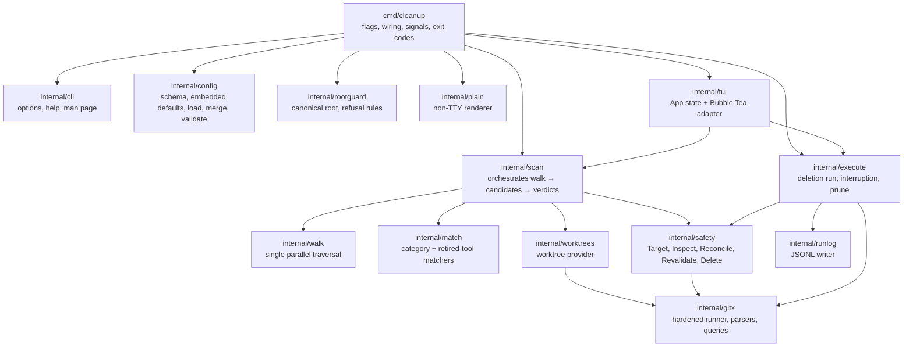

# cleanup — Architecture

Long-lived index. Unlike `intent.md`/`spec.md`/`design.md`/`plan.md`/`STATE.md`, this
file is never reset — `wrapup` appends to it at the end of every cycle. It is the sum of
every cycle's specifications plus the decisions made along the way, not a from-scratch
description of the system.

## Executive overview

`cleanup` is a Go CLI/TUI that reclaims disk space under `~/Projects` from regenerable
build artifacts, stale git worktrees and leftovers of retired dev tools, without
deleting work. One parallel walk produces candidates; `internal/safety` inspects each one
fail-closed (containment, tracked files, git state with a hardened git runner, age) and
is the only package that can build a deletion target or remove files. Deletion is a
dry run by default, revalidates each target just before acting, goes through `os.Root`,
and is logged as JSONL.

## Cycle index

| Date | Slug | Summary | Archive |
|---|---|---|---|
| 2026-11-19 | 2026-11-19-cleanup-v1-a-safe-clean-go-rebuild-of-the-gleanup-prototype | v1 Go rebuild of the gleanup prototype: fail-closed safety core, hardened git, TUI (Bubble Tea v2) and plain modes, run log, benchmark. | [SPEC](archive/2026-11-19-cleanup-v1-a-safe-clean-go-rebuild-of-the-gleanup-prototype/SPEC.md) · [TECH-DESIGN](archive/2026-11-19-cleanup-v1-a-safe-clean-go-rebuild-of-the-gleanup-prototype/TECH-DESIGN.md) |
