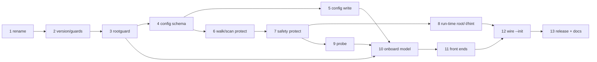

# cleanup v0.0.1: installation and first-run onboarding — Implementation Plan

**Author**: John Fricker.
**Derived from**: [SPEC.md](SPEC.md), [TECH-DESIGN.md](TECH-DESIGN.md) (approved 2026-11-21).
**Last updated**: 2026-11-21.
**Status**: Approved.
**Approved by**: John Fricker (2026-11-21).

## Context

Approved SPEC and TECH-DESIGN (2026-11-21) define v0.0.1: install via `go install` and
GoReleaser binaries with a correct version; `project_root` and `protected_paths` config
keys honoured at run time; and a three-step onboarding (`--init` plus automatic first
run) that writes a minimal, validated config. This plan sequences that design into
commits that each pass `make check`, adding the named acceptance tests (`TestAC_*`)
step by step.

## Steps

Every step ends with `make check` green and one commit. Step 1 is a pure rename; every
later step adds its named AC tests with the code.

1. **Module rename (INST-1).** `go mod edit -module github.com/jfricker/cleanup`;
   literal rewrite of `"cleanup/internal/` imports in all `.go` files. No other edits.
2. **Guards and version (INST-2/3, VER-1/2).** New `cmd/cleanup/version.go`
   (`var version string`, `resolveVersion(ldflag, bi, ok)`); remove `"0.1.0-dev"` from
   `main.go`; pass the resolved string to `--version`, `cli.Help`, `cli.Man`. Tests:
   `TestAC_V1` (table: ldflag, `(devel)`, pseudo-version, `v0.0.1`, `v0.0.1+dirty`; plus
   a binary built with `-ldflags -X`), `TestAC_I2` (no `import "C"` in non-test
   sources), `TestAC_I3` (no install/uninstall/release Makefile target), `TestAC_I1`
   (`go install ./cmd/cleanup` with `GOBIN=t.TempDir()` runs `--version`). Goldens via
   `make golden`.
3. **rootguard helpers (PROOT-2).** Export `Home()` (wraps existing `homeDir()` in
   `internal/rootguard/rootguard.go`) and add `Expand(p, home)`. Unit tests.
4. **Config schema (PROOT-4, PROT-3, DOC-5).** `rawFile.ProjectRoot`,
   `rawFile.ProtectedPaths`, `Config.ProjectRoot`, `Config.ProtectedPaths` in
   `internal/config/{raw,types,load}.go`; validation in `validate` using
   `locate`/`LoadError` for lines; merge replaces. Commented examples in
   `defaults.toml`. Tests: `TestAC_P2`, `TestAC_P4` (load half), `TestAC_K8`.
5. **Config writing (CFGW-1…6).** New `internal/config/write.go`: `Changes`,
   `Plan(existing, ch)`, `Write(path, data, now)`. `omitempty` on `rawRule`'s non-pointer
   fields. Fixed temp `.config.toml.new`; `O_EXCL` backups with `-N` suffix. Test-only
   `writeHooks` seam to force validation failure / stop before rename. Tests:
   `TestAC_K1`, `K2`, `K3`, `K4`, `K5`, `K7`. `TestNFR4_OnlySafetyDeletes` must stay
   green.
6. **Walk and scan protection (PROT-4, PROT-5).** `walk.Options.Protected` (set lookup
   before visiting/descending). `scan.Options.Protected` passed to the walk and to
   `safety.Config.Protected`. PROT-5: for each `wres.GitTrees` linked worktree, reuse
   `git.Dirs` (`internal/gitx/queries.go`, `Dirs.Linked()`) to get `CommonDir`; if the
   main repo is at/under a protected path, append it to `repos` before
   `worktrees.Find`.
7. **Safety protection (PROT-6).** `safety.Config.Protected`, `ReasonProtectedPath`;
   `Inspect` check after containment (at / under / contains protected);
   `NewDeleter(in, protected)` and a protected check first in `revalidate`. Update
   callers (`cmd/cleanup/app.go` `execute`, execute tests). Tests: `TestAC_P5`,
   `TestAC_P6`, safety unit tests.
8. **Run-time root, hint and `-l` (CLI-11, PROOT-5, PROT-7, TRIG-3/4).** In
   `cmd/cleanup`: `defaultConfigPath()` → `(path, exists)`;
   `resolveRoot(opts, cfg, home)` with `rootSource`; pure `decideStart` (hint/run
   only); `execute` reloads config strictly before deletion and passes reloaded
   `ProtectedPaths` to `NewDeleter`, aborting if the reload fails. `-l` root header and
   protected status lines. `run(args, env)` refactor (Stdin, Stdout, Stderr,
   Interactive, Getenv, Executable, Now); `main.go` passes real values. `-r` help text.
   Tests: `TestAC_P1`, `P3`, `P4` (`missing` in `-l`), `P8`, `TestAC_P7` (in-process
   via `execute`), `TestAC_N3` (binary through a pipe: hint on stderr, stdout matches
   `dryrun.golden`), `N4`, `N5`, `N6`. Goldens regenerated and diff reviewed.
9. **Probe (TOOL-1…6, NFR-8).** `scan.ToolFootprint`, `scan.Probe` wrapping `Run` with
   `Only=[retired]`, `Retired=cfg.ToolIDs()`, worktrees off; group by tool, count
   eligible and fresh. Tests: `TestAC_T1`, `T2`, `T3` (probe age == inspector verdict
   age, loose and in-git-tree). `BenchmarkProbe` (`TestAC_T5`) in
   `internal/scan/bench_test.go` on the NFR-1 fixture, not in `make test`.
10. **Onboarding model.** New `internal/onboard`: `Deps`, `Initial`, `Flow` (SetRoot,
    AddProtected, RemoveProtected, Next, Back, SetProbe, ToggleTool, Changes, Summary).
    Pure; filesystem only via `Deps.ResolveRoot` and `os.Stat` against the canonical
    root. Root change drops protected entries no longer under it, with a message.
    Tests: `TestAC_O2` (logic), `O4`, `T4`, Changes formatting.
11. **Front ends (ONB-1/3, TOOL-7, NFR-10).** `internal/plain/onboard.go`
    (`Onboard(ctx, r, w, f)`, reader goroutine so EOF and context both cancel).
    `internal/tui/onboard.go`: `OnboardModel` (pure update + thin adapter, as in
    `internal/tui/program.go`), hand-rolled line editor, probe as a `tea.Cmd` with
    progress, `RunOnboard` returns `errTUIUnavailable` on pre-first-frame failure.
    Existing palette and `NO_COLOR` handling from `view.go`. Tests: plain golden
    transcripts; TUI model tests covering `TestAC_O5`, `TestAC_O6` and an 80×24
    snapshot.
12. **Wire onboarding (CLI-7…10, TRIG-1/2/5, ONB-1/5, CFGW-7).** `cli`: `Options.Init`,
    flag, CLI-8 conflicts via `fs.Visit`. `cmd/cleanup`: `decideStart` gains
    `startOnboard`/`startOnboardOnly`; wiring (load target → `Initial` → `Deps`, probe
    with a new git runner and the signals context); front end choice (`-T` or
    `TERM=dumb` → plain, else TUI with plain fallback); `config.Plan` → `config.Write`
    → summary; `pathWarning(executable, PATH, SHELL)`. Tests (in-process `run` with
    `env.Interactive`): `TestAC_N1`, `N2`, `N7`, `N8`, `N9`, `TestAC_O1`, `O3`, `O7`,
    `O8`, `K6`, `TestAC_O9` (tree hash unchanged; wrapper `git` on PATH logs
    subcommands, none write). Goldens regenerated.
13. **Release files and docs (INST-4…6, DOC-3/4).** `.goreleaser.yaml` and
    `.github/workflows/release.yml` per the design, actions pinned by SHA (looked up at
    implementation time). `.gitignore`: `dist/`, `dist-extra/`. README: install, PATH,
    checksum + `xattr`, man page, removal, `--init`, `project_root`,
    `protected_paths`, first run and hint; remove `doctl`/`make install` boilerplate.
    Man text via `internal/cli/man.go`. `goreleaser check` and
    `goreleaser release --snapshot --clean` locally if available (AC-I4/I5), else
    recorded as manual in STATE.md.

## Files touched

- **New**: `cmd/cleanup/version.go`, `cmd/cleanup/onboard.go`,
  `internal/config/write.go`, `internal/onboard/{onboard.go,onboard_test.go}`,
  `internal/plain/onboard.go`, `internal/tui/onboard.go` (+ tests),
  `.goreleaser.yaml`, `.github/workflows/release.yml`.
- **Modified**: `go.mod` and every `.go` import (step 1 only);
  `cmd/cleanup/{main,app,tui,app_test}.go`, `cmd/cleanup/testdata/*.golden`;
  `internal/cli/{cli,man}.go`; `internal/config/{raw,types,load,config_test}.go`,
  `internal/config/defaults.toml`; `internal/rootguard/rootguard.go`;
  `internal/walk/walk.go`; `internal/scan/{scan,scan_test,bench_test}.go`;
  `internal/safety/{inspect,verdict,delete,safety_test}.go`;
  `internal/execute/execute_test.go`; `internal/testfix` (fixture helpers if needed);
  `README.md`, `.gitignore`.

## Sequencing

The rename goes first so no later diff mixes it in. Protection (6–7) lands before the
probe (9), which relies on protected pruning (AC-T2).

## Risks / rollback

- **Rename churn**: isolated in commit 1; revert that commit.
- **Golden drift**: steps 2, 8, 12 change help/man/list; regenerate with `make golden`
  and review the diff; never delete goldens (NFR-11).
- **`NewDeleter` signature change** breaks callers at compile time; fixed in the same
  commit (step 7).
- **Interactive test seam** must not exist in the shipped binary: prefer in-process
  `run(args, env)`; a build-tagged hook if a binary e2e needs it, never an env var the
  release honours.
- **TUI start-failure fallback** is unit-tested via an injected program error.
- **Worktree ops / git fixtures** may need to run unsandboxed (AGENTS.md).
- **GoReleaser config and action SHAs** can't be verified before the tag; the snapshot
  run is the check. Tagging `v0.0.1` is a manual operator step (INST-7).
- **Rollback**: one commit per step, each revertible; config writing is reachable only
  through `--init` and the first run.

## Verification plan

- `make check` after every step (unsandboxed; `govulncheck` needs network).
- Every automated SPEC AC maps to a named `TestAC_*`; at the end,
  `go test ./... -run 'TestAC_' -v` plus a grep confirms every AC ID has a test.
- `make bench` for `BenchmarkProbe` against the NFR-1 budget (AC-T5/NFR-8).
- End to end with a scratch `HOME`/`XDG_CONFIG_HOME`: interactive `./cleanup` →
  onboarding → written file; `./cleanup` again → dry run of the chosen root;
  `./cleanup -l` shows root source and protected status; `echo | ./cleanup` prints the
  hint.
- TUI visual check is manual (AC-M2): light and dark terminal themes at 80×24. The
  chrome-devtools screenshot rule targets web UI and doesn't apply to a Bubble Tea
  TUI; recorded in STATE.md.
- Manual after the tag: AC-I4/I5 (goreleaser snapshot), AC-I6, AC-M1, AC-M3.
