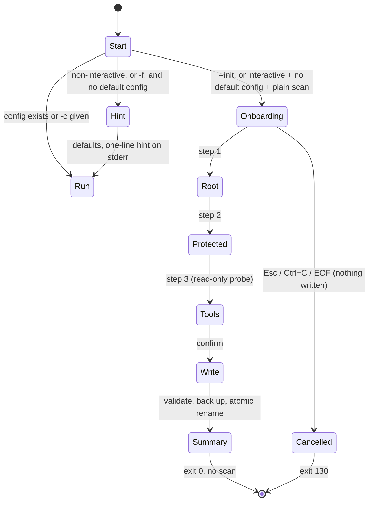

# cleanup v0.0.1: installation and first-run onboarding — Spec

**Author**: John Fricker.
**Derived from**: [INTENT.md](INTENT.md) (approved 2026-11-20).
**Last updated**: 2026-11-20.
**Status**: Approved.
**Approved by**: John Fricker (2026-11-20).

Requirement IDs are stable and are referenced by TECH-DESIGN, PLAN and tests. Every
requirement here is mandatory for v0.0.1. Requirements from the previous cycle
([archived SPEC](archive/2026-11-19-cleanup-v1-a-safe-clean-go-rebuild-of-the-gleanup-prototype/SPEC.md):
CLI-*, ROOT-*, CFG-*, WALK-*, AGE-*, INSP-*, DEL-*, NFR-*) still hold unless a
requirement below amends them by ID.

## Terms

- **Default config path**: `$XDG_CONFIG_HOME/cleanup/config.toml` when
  `$XDG_CONFIG_HOME` is absolute, else `~/.config/cleanup/config.toml`.
- **Target config file**: the `-c FILE` path if given, else the default config path.
- **Interactive**: stdin and stdout are both TTYs.
- **Onboarding**: the three-step guided setup (project root, protected directories, old
  dev tools) followed by a summary. It runs as a TUI or as plain prompts.
- **Managed keys**: the only keys onboarding writes: `project_root`,
  `protected_paths`, and `retired` on entries of `[[retired_tools.tools]]`.
- **Footprint**: a directory or file matching a configured tool's `dirs` or `files`.

## Requirements

### Functional

#### Install and release (INST)

- **INST-1** The module path is `github.com/jfricker/cleanup`. Every internal import
  uses it. `go install github.com/jfricker/cleanup/cmd/cleanup@<tag>` and, from a
  clone, `go install ./cmd/cleanup` build a working binary.
- **INST-2** No package imports `"C"`, so binaries built with the default
  `CGO_ENABLED` behave the same as release builds (amends DOC-2: only release builds
  and `make build` are guaranteed static).
- **INST-3** The Makefile has no install, uninstall or release target (AGENTS.md:
  developer-only).
- **INST-4** `.goreleaser.yaml` builds `cmd/cleanup` with `CGO_ENABLED=0` for
  darwin/arm64, darwin/amd64, linux/arm64 and linux/amd64, and injects the tag as the
  version via `-ldflags`.
- **INST-5** Each release archive is `cleanup_<version>_<os>_<arch>.tar.gz` and
  contains `cleanup`, `cleanup.1` (generated by `cleanup -M` at release time) and
  `README.md`. The release publishes `checksums.txt` (SHA-256).
- **INST-6** `.github/workflows/release.yml` runs GoReleaser when a `v*` tag is pushed.
  It runs the same quality gate as `make check` before publishing and does not publish
  if the gate fails.
- **INST-7** The first release is tagged `v0.0.1`. Pushing the tag is a manual operator
  step.

#### Version (VER)

- **VER-1** `--version` prints `cleanup <version>`, where `<version>` is, in order of
  precedence: the `-ldflags` value (release builds); the main module version from
  `runtime/debug.ReadBuildInfo` when it is a tagged version (`go install …@v0.0.1`);
  otherwise `dev`. The hard-coded `0.1.0-dev` default is removed.
- **VER-2** The man page header uses the same version string.
- **VER-3** The config schema version stays the integer `version = 1` (CFG-2
  unchanged) and is unrelated to the release version.

#### CLI changes (CLI)

- **CLI-7** New flag `--init` (no short form, group "Information"): run onboarding,
  write the target config file, print the summary, exit. Help and man page list it.
- **CLI-8** `--init` may be combined only with `-c`, `-r` and `-T`. Any other flag is a
  usage error (exit 2) naming the conflicting flag.
- **CLI-9** `--init` when not interactive is a usage error (exit 2):
  "`--init needs an interactive terminal`".
- **CLI-10** `--init -r DIR` pre-fills step 1 with DIR (after tilde expansion); the
  user may still change it.
- **CLI-11** `-r DIR` (and the positional root) overrides `project_root` for that run.
  With neither, the root is `project_root` if set, else `~/Projects` (amends CLI-1's
  default).

#### Onboarding trigger (TRIG)

- **TRIG-1** Onboarding starts automatically only when all of these hold: interactive; the
  default config path does not exist; no `-c`; none of `-f`, `-T`, `-P`, `-M`, `-l`,
  `-h`, `-V`. Otherwise no onboarding.
- **TRIG-2** When onboarding starts automatically, the run does onboarding only: it
  never scans or deletes afterwards, even with `-d`. After the summary it exits 0.
- **TRIG-3** When the default config path does not exist, no `-c` is given and
  onboarding does not start, a normal run (not `-P`, `-M`, `-l`, `-h`, `-V`) prints
  exactly one line to stderr: `cleanup: no config yet; run "cleanup --init" to set
  your project root and retired tools`. Stdout is unchanged (PLAIN-3 goldens still
  hold).
- **TRIG-4** A plain run whose `-c FILE` does not exist is a config error (exit 2), as
  today. Only the default path triggers onboarding or the hint.
- **TRIG-5** No code path reads stdin unless interactive (onboarding included). CI,
  pipes and `-f` runs never block on input.

#### Onboarding flow (ONB)

- **ONB-1** Onboarding uses the TUI when interactive, unless `-T` is given,
  `TERM=dumb`, or the TUI fails to start; then it uses plain prompts (line-by-line
  questions on stdout, answers read from stdin). Both front ends implement the same
  steps, validation and output.
- **ONB-2** On `--init` with an existing target config file, every step is pre-filled
  from that file merged over the defaults.
- **ONB-3** Esc or Ctrl+C at any step, or EOF on stdin in plain mode, cancels:
  nothing is written, no backup is made, exit 130. Each step offers "back" to the
  previous step.
- **ONB-4** Onboarding never deletes, moves or modifies any file except the target
  config file and its backup. Only `internal/safety` removes files (NFR-4).
- **ONB-5** Before step 1, if the directory of the running executable
  (`os.Executable`, symlinks resolved) is not on `PATH`, onboarding shows a warning
  naming that directory and the line to add to the shell profile. It does not block.

#### Step 1: project root (PROOT)

- **PROOT-1** Step 1 shows the current root: `-r` (CLI-10), else existing
  `project_root`, else `~/Projects`. The user may accept or enter another path.
- **PROOT-2** Input is tilde-expanded (`~` and `~/…`, using the home directory from
  ROOT-2), must be absolute after expansion, must exist and be a directory, and must
  pass rootguard (ROOT-1 to ROOT-4). A rejected root shows the same reason text as
  ROOT-5 and the user stays on step 1.
- **PROOT-3** The saved value is written with a `~/` prefix when it is under home,
  otherwise as the canonical absolute path. It is omitted from the file when it equals
  the default `~/Projects`.
- **PROOT-4** Config: `project_root` is an optional top-level string. At load it is
  tilde-expanded; a relative value is a config error (exit 2, file and line).
- **PROOT-5** At run time, a `project_root` that does not exist, is not a directory, or
  is refused by rootguard is an error (exit 2) naming the root, the config file and the
  reason, and suggesting `cleanup --init` or `-r DIR`. There is no fallback to
  `~/Projects`. `-r` bypasses the saved value entirely.

#### Step 2: protected directories (PROT)

- **PROT-1** Step 2 lists the current `protected_paths` and lets the user add and
  remove entries. Input accepts a path relative to the chosen root, or an absolute or
  `~` path under it, which is converted to root-relative.
- **PROT-2** An entry is rejected (user stays on step 2, with the reason) if it is
  empty, `.`, absolute after conversion, contains `..`, is outside the root, does not
  exist, is not a directory, or duplicates or is nested inside another entry.
- **PROT-3** Config: `protected_paths` is an optional top-level array of strings. At
  load, an entry that is absolute, contains a `..` component, is empty or `.`, or (after
  joining) resolves outside the root is a config error (exit 2, file and line). An
  entry that does not exist at run time is not an error; it protects nothing and `-l`
  lists it as `missing`.
- **PROT-4** Protected paths are resolved against the run's root (so with `-r` they
  apply relative to that root). The walk does not descend into a protected path or
  report anything at or under it (extends WALK-3). They apply to every cleaner,
  including the worktrees provider and retired tools.
- **PROT-5** Protection follows location on disk: a linked worktree at or under a
  protected path is never proposed; a linked worktree elsewhere under the root whose
  main repo is protected is still proposed.
- **PROT-6** At delete time (revalidation, DEL-*), `internal/safety` refuses any target
  at or under a protected path of the *current* config with verdict
  `protected(protected path)`, and any target that contains a protected path. This holds
  even if the item was selected before the config changed.
- **PROT-7** `-l` prints the project root (and its source: flag, config or default) and
  each protected path with `ok` or `missing`.

#### Step 3: old dev tools (TOOL)

- **TOOL-1** Step 3 runs a read-only probe of the chosen root for footprints of every
  configured tool, regardless of its `retired` value. It uses the single parallel walk
  (WALK-1) with the same pruning a real retired-tools scan uses: it skips `never_touch`
  names and the protected paths entered in step 2.
- **TOOL-2** For each tool with at least one footprint, step 3 shows: name, item count,
  total size, and age = the youngest item's age, where each item's age is the age the
  run-time gate computes for it (AGE-1 inside a git tree, AGE-2 deep age otherwise).
  Tools are sorted by age, most recently modified first.
- **TOOL-3** A tool with items younger than its effective `age_days` shows a note
  "`N items too recent to clean yet (< D days)`". It is still listed and selectable.
- **TOOL-4** Tools with no footprint are not shown. If no tool has a footprint, step 3
  says so and offers continue.
- **TOOL-5** The user toggles tools on (retired) or off. The pre-selection is each
  tool's current `retired` value.
- **TOOL-6** The probe performs no git writes and no file writes. It honours Ctrl+C
  (ONB-3) within 250 ms (NFR-2).
- **TOOL-7** Step 3 shows progress while probing and stays responsive (NFR-2).

#### Writing config (CFGW)

- **CFGW-1** The written file contains `version = 1` and only the managed keys whose
  merged value differs from the embedded defaults, plus every key from the existing
  target file that is not a managed key, carried over unchanged in value.
- **CFGW-2** A tool marked retired is written as
  `[[retired_tools.tools]] id = "<id>"  retired = true`. A tool unmarked by the user
  has its `retired` override removed from its entry; an entry left with only `id` is
  dropped. Other fields on a tool entry are preserved.
- **CFGW-3** The new content is validated with the full strict loader (CFG-1 to CFG-7,
  PROOT-4, PROT-3) before anything touches disk. If it fails, nothing is written and the
  error is shown.
- **CFGW-4** If the target file exists, it is first copied to
  `config.toml.bak-<YYYYMMDDTHHMMSS>` (local time) in the same directory. An existing
  backup of the same name is never overwritten (append `-2`, `-3`, …). The backup keeps
  the original bytes, including comments.
- **CFGW-5** The write is atomic: a temp file in the same directory, `fsync`, then
  `rename` over the target. The config directory is created with mode `0700` if
  missing; the file is written `0600`.
- **CFGW-6** Comments and formatting in the existing file are not preserved (the backup
  keeps them). The summary says so when a file was replaced.
- **CFGW-7** The summary lists: the file written, the backup path (if any), the project
  root, protected paths, tools marked retired, and the next command to try:
  `cleanup` (dry run).

#### Docs (DOC)

- **DOC-3** README install section covers: `go install …/cmd/cleanup@latest`, the
  `$(go env GOPATH)/bin` / `$GOBIN` location and the `PATH` export line; `go install
  ./cmd/cleanup` from a clone; release downloads with checksum verification and the
  macOS `xattr -d com.apple.quarantine` step; man page via `cleanup -M` or the archive's
  `cleanup.1`; removal (delete the binary; config is left in place). It mentions no
  `make install`.
- **DOC-4** README and man page document `--init`, `project_root`, `protected_paths`,
  first-run behaviour and the non-TTY hint.
- **DOC-5** `--print-config` output documents `project_root` and `protected_paths` as
  commented examples and still round-trips (CFG-7).

### Non-functional

- **NFR-8 Probe performance**: on the NFR-1 benchmark fixture, the step 3 probe finishes
  in ≤ the NFR-1 dry-run budget.
- **NFR-9 No new network access**: the binary makes no network calls (NFR-7 unchanged);
  only CI and GoReleaser use the network.
- **NFR-10 Accessibility**: onboarding works without colour (`NO_COLOR`, light and dark
  terminals) and fits 80×24; every TUI action has a visible key hint; plain prompts are
  usable with a screen reader (no cursor tricks, one question per line).
- **NFR-11 Gate**: `make check` stays green; help and man goldens are updated, not
  deleted.

## Acceptance criteria

Each criterion maps to an automated test `TestAC_<ID>_…` unless marked *(manual)*.
Fixtures run in `t.TempDir()` with `XDG_CONFIG_HOME` and `HOME` scrubbed; interactive
cases drive the plain front end through pipes marked interactive by a test seam, and
the TUI through `teatest`-style model tests.

### Install, release and version

- **AC-I1** `go.mod` declares `module github.com/jfricker/cleanup`; `go build ./...`
  and `go install ./cmd/cleanup` with `GOBIN=<tmp>` produce a binary that runs
  `--version`.
- **AC-I2** No `.go` file outside tests imports `"C"`.
- **AC-I3** The Makefile has no `install`, `uninstall` or `release` target.
- **AC-I4** `goreleaser check` passes and `goreleaser build --snapshot --clean` produces
  the four targets *(manual, CI)*.
- **AC-I5** A snapshot release archive contains `cleanup`, `cleanup.1` and `README.md`,
  and `checksums.txt` matches *(manual)*.
- **AC-I6** After tagging `v0.0.1`: `go install github.com/jfricker/cleanup/cmd/cleanup@v0.0.1`
  in a clean `GOPATH` works and `cleanup --version` prints `cleanup v0.0.1`; a release
  binary prints the same *(manual)*.
- **AC-V1** With no ldflags and no tagged build info, `--version` prints `cleanup dev`;
  with `-ldflags -X …=v0.0.1` it prints `cleanup v0.0.1`.

### Trigger and CLI

- **AC-N1** Interactive, no default config, no flags: onboarding starts and no scan
  runs.
- **AC-N2** Same with `-d`: onboarding runs, then the process exits 0 with no
  deletion and no scan.
- **AC-N3** Non-interactive stdin or stdout, no default config: the run scans with
  defaults, stderr has exactly the TRIG-3 line, stdout matches the existing golden,
  and the process never reads stdin.
- **AC-N4** `-f -d` with no default config never prompts and prints the hint.
- **AC-N5** `-P`, `-M`, `-l`, `-h`, `-V` with no default config print no hint and
  start no onboarding.
- **AC-N6** `-c missing.toml` exits 2 with a config error and does not start
  onboarding.
- **AC-N7** `--init` non-interactive exits 2 with the CLI-9 message.
- **AC-N8** `--init -d`, `--init -f`, `--init -P` each exit 2 naming the flag; `--init
  -c f -r d -T` is accepted.
- **AC-N9** Help and man goldens list `--init`.

### Onboarding flow

- **AC-O1** Plain prompts: accepting every default on a fresh home writes a file that
  loads with the strict loader and contains only `version = 1` (see Flagged concern
  2).
- **AC-O2** Step 1 rejects `~` (home), `/`, `~/Library/x` and a nonexistent path, each
  with the ROOT-5 reason, and accepts `~/Code` (saved as `project_root = "~/Code"`).
- **AC-O3** `--init -r ~/Code` pre-fills step 1 with `~/Code`.
- **AC-O4** Step 2 rejects `..`, `../x`, an absolute path outside the root, a missing
  dir, a file, a duplicate and a nested entry; accepts `clients/acme` and an absolute
  path under the root (stored root-relative).
- **AC-O5** EOF at step 2 in plain mode: exit 130, no file, no backup.
- **AC-O6** TUI: Esc at step 3 exits 130 and writes nothing; "back" from step 3 returns
  to step 2 with entries intact.
- **AC-O7** With the executable's directory not on `PATH`, onboarding shows the ONB-5
  warning; with it on `PATH`, no warning.
- **AC-O8** `TERM=dumb` interactive uses plain prompts.
- **AC-O9** During onboarding (all three steps on a fixture with footprints and git
  trees) no file under the root changes (tree hash before == after) and no git command
  with a write subcommand runs.

### Project root and protected paths at run time

- **AC-P1** `project_root = "~/Code"` scans `~/Code`; `-r X` scans `X` instead.
- **AC-P2** `project_root = "rel/dir"` is a config error with file and line.
- **AC-P3** `project_root` pointing to a deleted dir or to `~` exits 2 with the PROOT-5
  message; no scan of `~/Projects` happens.
- **AC-P4** `protected_paths = ["/abs"]`, `["../x"]`, `["a/../../b"]`, `[""]` each fail
  with file and line; a missing entry is accepted and shown as `missing` by `-l`.
- **AC-P5** A `__pycache__`, a `node_modules`, a retired-tool footprint and a linked
  worktree under `protected/` are not reported in a dry run; the same items outside it
  are.
- **AC-P6** A repo under `protected/` with a stale linked worktree outside it: the
  worktree is proposed (PROT-5).
- **AC-P7** Select an item, then add its parent to `protected_paths` before
  confirming: deletion refuses it with `protected(protected path)` and nothing is
  removed (PROT-6).
- **AC-P8** `-l` shows root source and protected path status.

### Step 3 probe

- **AC-T1** Fixture with `.cursor/` (40 d), `.aider.chat.history.md` (2 d) and no
  `.windsurf`: step 3 lists Aider then Cursor, omits Windsurf, and Aider carries the
  TOOL-3 note.
- **AC-T2** A footprint under a step-2 protected path and one under a `never_touch`
  name are not counted.
- **AC-T3** Step 3 age equals the age the inspector computes for the same item (deep
  for loose dirs, shallow inside a git tree).
- **AC-T4** Pre-selection reflects existing `retired` values on `--init`.
- **AC-T5** On the NFR-1 fixture the probe finishes within the NFR-1 budget
  (benchmark, not run in `make test`).

### Writing config

- **AC-K1** An existing file with a custom category, a `never_touch` entry and a
  comment: `--init` marking one tool retired keeps the category and `never_touch`
  values, drops the comment, writes `config.toml.bak-<ts>` with the original bytes, and
  the new file loads strictly.
- **AC-K2** Two `--init` runs in the same second produce two distinct backups; neither
  is overwritten.
- **AC-K3** Unmarking a tool that was `retired = true` with no other fields drops its
  entry; with `age_days = 10` also set, the entry keeps `age_days` and loses
  `retired`.
- **AC-K4** A failed validation (forced via test seam) writes nothing and makes no
  backup.
- **AC-K5** A crash between temp write and rename (simulated) leaves the original file
  intact; no partial target file exists.
- **AC-K6** `--init -c other.toml` writes `other.toml` and leaves the default path
  untouched.
- **AC-K7** New config dir is `0700`, file is `0600`.
- **AC-K8** `--print-config` still round-trips and shows commented `project_root` and
  `protected_paths` examples.

### Manual

- **AC-M1** *(manual)* Fresh macOS user: `go install …@v0.0.1`, run `cleanup`,
  complete onboarding in under 2 minutes without editing TOML, then a dry run scans the
  chosen root.
- **AC-M2** *(manual)* Onboarding TUI in light and dark terminal themes at 80×24: all
  hints readable, no truncated controls.
- **AC-M3** *(manual)* Downloaded darwin/arm64 release binary runs after the README
  quarantine step.

## Flagged concerns

All resolved by the operator on 2026-11-20.

1. **`--plain` vs `-T, --no-tui`.** Resolved: use the existing `-T, --no-tui`; no new
   flag.
2. **Accept-all-defaults on first run (AC-O1).** Resolved: always write the file (at
   minimum `version = 1`) so onboarding doesn't re-trigger.
3. **Missing protected paths at run time (PROT-3).** Resolved: a nonexistent entry is a
   no-op, listed as `missing` by `-l`; not a config error.
4. **README badges and missing LICENSE.** Resolved: drop the badges (no LICENSE or
   `validations.yaml` workflow this cycle). The remaining boilerplate (`doctl`,
   `make install`) is replaced under DOC-3.
5. **Release gate in CI (INST-6).** Resolved: the release workflow may run `make check`;
   AGENTS.md's "developer-only" means not an end-user or release-packaging tool.
   GoReleaser does the build.
6. **Auto-trigger with `-d` (TRIG-2).** Resolved: confirmed as in INTENT; the summary
   tells the user to re-run their command.

## Open questions

- **Deferred** (operator, 2026-11-20), carried forward from INTENT: SwiftPM
  `.build/checkouts` strictness. Not part of this cycle.
