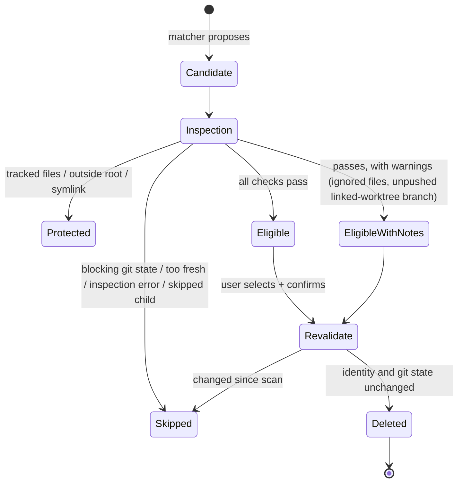

# cleanup v1: a safe, clean Go rebuild of the gleanup prototype — Spec

**Author**: John Fricker.
**Derived from**: [INTENT.md](INTENT.md) (approved 2026-11-19).
**Last updated**: 2026-11-19.
**Status**: Approved.
**Approved by**: John Fricker (2026-11-19).

Requirement IDs are stable and are referenced by TECH-DESIGN, PLAN and tests. "Must" is
mandatory for v1. Bug IDs R1–R5 and finding numbers (#7, #12, …) refer to
[reference/prototype-review.md](reference/prototype-review.md).

## Terms

- **Root**: the canonical (symlinks resolved, absolute) scan directory for one run.
- **Candidate**: a path a matcher (category rule, worktree provider, retired tool)
  proposes for cleanup.
- **Inspection**: the single step that turns a candidate into a verdict.
- **Verdict**: exactly one of `eligible`, `eligible-with-notes`, `skipped(reason)`,
  `protected(reason)`. Only `eligible*` verdicts carry a **verified target**.
- **Verified target**: an unexported Go type that only the inspection package can
  construct. Deletion functions accept only this type.
- **Git tree**: a directory that contains a `.git` dir or `.git` file (repo, linked
  worktree, submodule).
- **Full clone**: a git tree that is not a linked worktree of another repo.

## Requirements

### Functional

#### CLI (CLI)

- **CLI-1** Flags, at parity with gleanup except where noted:

  | Flag | Meaning |
  |---|---|
  | `-n, --dry-run` | Preview only (default). Last of `-n`/`-d` wins. |
  | `-d, --delete` | Delete selected items. Needs TUI confirmation or `--force`. |
  | `-f, --force` | Skip the TUI and confirmation; only meaningful with `--delete`. |
  | `-T, --no-tui` | Plain-text mode. |
  | `-r, --root PATH` | Scan root (default `~/Projects`). |
  | `-c, --config PATH` | Config file (default `~/.config/cleanup/config.toml` if present). |
  | `-P, --print-config` | Print the embedded default config and exit. |
  | `-l, --list-categories` | List categories, providers and retired tools with enabled state, then exit. |
  | `-o, --only IDS` / `-x, --exclude IDS` | Comma-separated or repeatable cleaner IDs. |
  | `-v, --venvs` | Include marker-verified virtualenvs. |
  | `-m, --modules` | Include `node_modules`. |
  | `-a, --age DAYS` | Override every provider's and retired tool's `age_days` for this run. |
  | `-D, --include-dirty` | Relax the git conditions listed in GIT-5. |
  | `-u, --retired IDS` | Treat configured tool IDs as retired for this run (replaces `--defunct`). |
  | `-s, --show-skipped` | Show skipped and protected items. |
  | `-g, --group-by cleaner\|project` | Initial TUI grouping. |
  | `-M, --print-man` | Print the roff man page and exit. |
  | `-h, --help` / `-V, --version` | Help / version. |

- **CLI-2** There is no `-y`. Passing `-y` is a usage error whose message points to `-d`.
- **CLI-3** Help text lists `-d, --delete` and `-D, --include-dirty` in separate groups
  ("Mode" and "Safety overrides"). `-D`'s line starts with `UNSAFE:`.
- **CLI-4** Unknown IDs in `--only`, `--exclude` or `--retired` are usage errors that
  list valid IDs.
- **CLI-5** `--delete` without a TTY and without `--force` is a usage error. Plain mode
  never prompts.
- **CLI-6** Exit codes: `0` success (including dry run with matches); `1` one or more
  deletions failed; `2` usage, config or root-guard error; `130` interrupted.

#### Root guard (ROOT)

- **ROOT-1** The root is canonicalised (`filepath.Abs` + `EvalSymlinks`), and the
  canonical value is what every later step uses.
- **ROOT-2** The home directory is taken from the password database (`os/user`), not
  `$HOME`.
- **ROOT-3** Refused roots (exact match, after canonicalisation): `/`, the home
  directory, any ancestor of home, `~/Documents`, `~/Desktop`, `~/Downloads`.
- **ROOT-4** Refused roots (the path or anything under it): `/System`, `/Library`,
  `/Applications`, `/usr`, `/bin`, `/sbin`, `/etc`, `/var`, `/private`, `/opt/homebrew`,
  `~/Library` (which covers iCloud Drive at `~/Library/Mobile Documents` and
  `~/Library/CloudStorage`). On Linux: `/proc`, `/sys`, `/dev`, `/boot`, `/usr`,
  `/etc`, `/var`, `/bin`, `/sbin`, `/lib*`.
- **ROOT-5** A refused root exits `2` with the canonical path and the rule that refused
  it.

#### Config (CFG)

- **CFG-1** The embedded default config is the base. A user file is merged over it:
  tables merge by ID, scalars replace, and a category's `rules` array replaces that
  category's rules only when the user sets `rules`.
- **CFG-2** The user file must contain `version = 1`. Missing or another value is a load
  error explaining the change from the prototypes and pointing to `--print-config`.
- **CFG-3** Unknown keys anywhere (via `toml.MetaData.Undecoded()`) are load errors that
  name the file, line and key, and suggest the closest valid key.
- **CFG-4** Enumerated fields (`kind`, `strategy`, `opt_in`, `group_by`) decode into
  validated Go types. An unknown value is a load error. A rule without `strategy` uses
  `remove`; an invalid strategy never falls back to anything.
- **CFG-5** Over-broad patterns are load errors: names or globs that are empty, `.`,
  `..`, contain `/`, consist only of wildcards (`*`, `**`, `?*`, `*.*`), or match
  `.git`.
- **CFG-6** `.git` is always in `never_touch` and cannot be removed by user config.
- **CFG-7** `--print-config` output loads cleanly as a user config (round-trip).

#### Traversal (WALK)

- **WALK-1** One traversal of the root per run feeds all category matchers, retired-tool
  matchers and git-tree discovery. Each directory is read at most once.
- **WALK-2** The walk never follows symlinks. Symlinks are never candidates.
- **WALK-3** The walk does not descend into `never_touch` directories, into a candidate
  after it is recorded (its subtree is inspected separately, see INSP-5), or into a
  category's `prune` list for that category.
- **WALK-4** The walk stays on the root's filesystem device.
- **WALK-5** Walk errors (permission denied, vanished entries) are recorded and shown.
  An unreadable directory makes any candidate containing it `skipped(inspection
  failed)`.

#### Category engine (CAT)

- **CAT-1** Built-in categories match gleanup's defaults: python (with the `venvs`
  opt-in), node (with the `modules` opt-in), rust, swift, gradle, cmake,
  test-artifacts, and macos (disabled by default).
- **CAT-2** Rule features: `kind` (`dir`/`file`), `names`, `globs`,
  `require_self_markers`, `require_sibling_markers`, `require_ancestor_markers`,
  `opt_in`, `strategy` (`remove`, `empty-contents`), `warning`, `badge`, `category`.
- **CAT-3** When several rules match the same path, it appears once, attributed to the
  cleaner with the lowest `sort_order`.

#### Git-worktrees provider (WT)

- **WT-1** Discovers repos found by the walk and lists their worktrees with
  `git worktree list --porcelain -z`.
- **WT-2** Only worktrees whose canonical path is under the root are candidates (#8).
  Out-of-root worktrees are reported as `protected(outside root)` under
  `--show-skipped`.
- **WT-3** Stale worktrees are those older than `providers.worktrees.age_days`
  (default 30). Gone (prunable) entries are cleaned with `git worktree prune`.
- **WT-4** Removal uses `git worktree remove <path>`, adding `--force` only when `-D` is
  set. If git refuses, the item is `failed(git refused: <stderr>)`. There is no
  filesystem fallback.
- **WT-5** `git worktree prune` runs once per affected repo after its removals,
  including after interruption.

#### Retired tools (RET)

- **RET-1** A tool is scanned only when its config entry has `retired = true`, or its ID
  is passed via `--retired`. No PATH, binary or app-path detection exists.
- **RET-2** The embedded defaults ship the prototype's tool list (orca, cursor, zed, pi,
  windsurf, aider, cline, roo, continue, fleet, sublime) with `retired = false`.
- **RET-3** Every retired tool has an age gate: `age_days`, default 30, minimum 1.
  `age_days = 0` is a load error.
- **RET-4** Tool dirs and files go through the same inspection as everything else:
  tracked files are protected, and nested git trees (including the tool dir itself,
  #10) get full git checks.

#### Inspection (INSP)

- **INSP-1** Every candidate passes through one inspection function. Its output is a
  verdict, and only `eligible*` verdicts carry a verified target.
- **INSP-2** Any error during inspection (git exit code, timeout, parse failure, stat
  failure) yields `skipped(inspection failed: <detail>)`. No error path yields
  `eligible`.
- **INSP-3 Containment**: the candidate's canonical path must be strictly under the
  root. Otherwise it is `protected(outside root)`.
- **INSP-4 Tracked files**: if the candidate is inside a git tree and any path at or
  under it is tracked (`git ls-files -z --` is non-empty), it is `protected(tracked
  files)`. There is no override.
- **INSP-5 Nested git trees**: every git tree inside a candidate is inspected with the
  GIT rules. If any is skipped, the candidate is skipped (`contains skipped git tree`).
- **INSP-6 Age**: candidates subject to an age gate are skipped as `fresh (Nd < Md)`
  when younger than the gate. Age is defined in AGE-1 and AGE-2.
- **INSP-7 Parents never override children (R1)**: after all verdicts are computed, any
  candidate that contains a skipped or protected candidate becomes
  `skipped(contains skipped item: <path>)`. Its eligible children stay individually
  selectable. Selecting a parent never deletes a skipped descendant.

#### Git rules (GIT)

- **GIT-1 Hardened invocation (#12, #15)**: git runs by absolute path (resolved once at
  start) with `-c core.fsmonitor=false -c core.hooksPath=/dev/null
  -c core.untrackedCache=false`. `GIT_*` variables are removed from the environment, and
  `GIT_CONFIG_NOSYSTEM=1`, `GIT_TERMINAL_PROMPT=0`, `GIT_OPTIONAL_LOCKS=0` and
  `LC_ALL=C` are set, plus `-c protocol.allow=never`. Each call has a timeout (default
  30 s). All porcelain output is read with `-z`.
- **GIT-1a Filter drivers** (amended 2026-11-19): before `git status`, every configured
  `filter.<name>` driver is neutralised with `-c filter.<name>.clean=
  -c filter.<name>.smudge= -c filter.<name>.process= -c filter.<name>.required=false`.
  Parent `status` runs with `--ignore-submodules=all`; submodules are inspected
  separately (GIT-4).
- **GIT-2 Blocking conditions** (any one → `skipped(<condition>)`):
  1. uncommitted changes (staged or unstaged);
  2. untracked, non-ignored files;
  3. full clones only: one or more stashes (amended 2026-11-19; stashes are repo-wide and
     survive linked-worktree removal, see GIT-3);
  4. a detached HEAD not reachable from any local or remote ref;
  5. lock state (`index.lock`, an in-progress merge/rebase/cherry-pick/bisect, or a
     locked worktree);
  6. full clones only: any commit on any local branch or tag that is not reachable from
     a remote-tracking ref (a clone with no remote counts as all-unpushed).
- **GIT-3 Notes, not blockers**:
  - A linked worktree whose branch has commits not on its upstream is
    `eligible-with-notes`, with the note `branch X has N unpushed commits; kept in
    <repo>`.
  - A linked worktree whose repo has stashes is `eligible-with-notes`, with the note
    `repo has N stashes; kept in <repo>`.
  - When git-ignored files are present, the item is `eligible-with-notes`, listing up to
    20 paths and a total count.
- **GIT-4** Submodules inside a candidate are git trees and get the GIT-2 checks.
- **GIT-5** `-D/--include-dirty` relaxes conditions 1, 2 and 4 of GIT-2 only.
  Full-clone stashes, locks, unpushed full-clone commits and tracked files are never relaxed. Items that are
  eligible only because of `-D` carry the note `eligible only because of
  --include-dirty`.

#### Age (AGE)

- **AGE-1 Shallow age (default)**: age = now − the most recent of: the newest mtime of
  the candidate itself and its top-level entries; and for a git tree, also the HEAD
  commit time and the mtime of its index file. Used wherever the GIT-2 checks also
  protect the item.
- **AGE-2 Deep age (where age is the only guard)**: for (a) git trees that are eligible
  only because of `-D`, and (b) retired-tool dirs and files that are not inside a git
  tree, age uses the newest mtime of any entry in the subtree. The deep walk skips
  symlinks, `never_touch`, the owning category's `prune` list, `.git/objects`, and
  (inside git trees) git-ignored paths. If the deep walk fails, the item is
  `skipped(inspection failed)`.

#### Deletion (DEL)

- **DEL-1** Deletion accepts only verified targets.
- **DEL-2 Revalidation (#13)**: immediately before deleting each item, re-check that the
  canonical path is unchanged, still under the root, has the same device and inode, is
  not a symlink, and (for git trees) still passes GIT-2. Any change →
  `skipped(changed since scan)`.
- **DEL-3** `remove` deletes the target without following symlinks inside it.
  `empty-contents` removes the children and keeps the directory.
- **DEL-4** One item's failure does not stop the run. Each failure is recorded once,
  with its error (#11).
- **DEL-5 Interruption (#7)**: the first Ctrl+C (or SIGTERM) stops after the current
  item, runs pending `git worktree prune`, writes the run log and reports exactly what
  was deleted, not deleted, and failed. A second Ctrl+C aborts the current item, which
  is reported as `partially deleted`. The exit code is `130`.
- **DEL-6** The completion report states the exact set of deleted paths and reclaimed
  bytes. It never claims "nothing deleted" when something was.

#### Run log (LOG)

- **LOG-1** Every `--delete` run appends one JSON Lines record per item, plus a start and
  an end record, to `$XDG_STATE_HOME/cleanup/runs.jsonl` (default
  `~/.local/state/cleanup/runs.jsonl`). Fields: run ID, timestamp, root, path, cleaner,
  bytes, outcome, error.
- **LOG-2** The log is opened before the first deletion. If it can't be opened, the run
  aborts before deleting anything (exit `2`).
- **LOG-3** The log is written even on interruption. It is the only file written outside
  the root.

#### TUI (TUI)

- **TUI-1** Five phases: scanning (live per-cleaner progress, current path, counts),
  review, confirmation, deleting (live progress), and completion summary.
- **TUI-2** Review: a collapsible tree grouped by cleaner or project (toggle), per-item
  and per-group selection, a text filter, and a detail panel showing verdict, reasons,
  notes, size, age and path.
- **TUI-3** Skipped and protected items are visible (collapsed unless `-s`), are shown
  with their reason, and cannot be selected.
- **TUI-4** The confirmation modal lists the count, the total size, every warning and
  every note (ignored files, unpushed linked-worktree branches, `-D` items). Default
  focus is "Cancel".
- **TUI-5** Quitting during the scan cancels the walk and leaks no goroutines.
- **TUI-6** Usable at 80×24 and above, with a single-column layout below 100 columns.
  Colours come from a palette with adaptive light/dark variants (lipgloss
  `AdaptiveColor`), and colour is never the only signal of state.

#### Plain mode (PLAIN)

- **PLAIN-1** Used when stdout is not a TTY or `--no-tui` is set. Lists eligible items
  grouped by cleaner, with size and notes, plus skipped items under `-s`.
- **PLAIN-2** Warnings and notes print before deletion. Failures print once, in the
  final summary.
- **PLAIN-3** Output is stable for golden tests: sorted paths, no colour when not a TTY,
  and `NO_COLOR` is honoured.

#### Docs and packaging (DOC)

- **DOC-1** `--print-man` emits a roff page generated from the same flag definitions as
  `--help`.
- **DOC-2** `go install` and `make build` produce a single static binary
  (`CGO_ENABLED=0`).

### Non-functional

- **NFR-1 Performance**: on the benchmark fixture (generated by a test helper: 300 repos
  and 30 `node_modules` trees of 20k files, about 1M entries), a dry-run scan finishes
  in ≤ 15 s on an Apple-silicon laptop, and in ≤ 2× the time of
  `find <root> -type d`.
- **NFR-2 Responsiveness**: the TUI handles keystrokes within 100 ms during scanning and
  deletion, and progress refreshes at least every 250 ms.
- **NFR-3 Concurrency**: bounded worker pools for inspection and size calculation
  (default `GOMAXPROCS`), with git calls capped at 8 concurrent.
- **NFR-4 Safety by construction**: deletion code lives in a package that cannot be
  called without a verified target. No `os.RemoveAll` or `os.Remove` call exists outside
  it, enforced by a test that scans the source tree.
- **NFR-5 Portability**: macOS primary, Linux best-effort, no cgo, Go version pinned in
  `go.mod`.
- **NFR-6 Engineering gate**: `make check` runs `gofmt -l` (must be empty), `go vet`,
  `staticcheck`, `govulncheck` and `go test -race ./...`. `.gitignore` excludes the
  binary and build output, and `go mod tidy` leaves no diff. `AGENTS.md` documents the
  gate and dev commands, and `.metaproject.json` sets the lint command.
- **NFR-7 Privacy**: no network access of any kind.

## Acceptance criteria

Each criterion maps to an automated test unless marked *(manual)*. Fixtures are built in
`t.TempDir()` with real `git` and a scrubbed environment.

### Regression scenarios from the review

- **AC-R1** A retired `.orca` dir (age 40d) contains a fresh workspace (age 0d) and a
  locked worktree. `.orca` is `skipped(contains skipped item)`, the workspace is
  `skipped(fresh)` and the locked worktree is `skipped(locked)`. With
  `--delete --force`, none of them is removed.
- **AC-R2** A full clone has (a) a local-only branch commit, (b) a stash and (c) an
  ignored `.env`. (a) and (b) each independently make it `skipped`. With only (c), it is
  `eligible-with-notes` listing `.env`, and the note appears in plain output and in the
  confirmation modal.
- **AC-R3** A tracked `web/build/` under `package.json` is `protected(tracked files)` and
  survives `--delete --force`. An untracked sibling `web/dist/` is eligible.
- **AC-R4** With `PATH=/usr/bin:/bin`, a `.cursorrules` file and a `.cursor/` dir at age
  0d are not candidates unless `cursor` is retired. When it is retired, they are
  `skipped(fresh)`. A committed `.cursorrules` is `protected(tracked files)` at any age.
- **AC-R5** A user config with `require_sibling_marker = ["Cargo.toml"]` fails to load
  with exit `2`, naming the file and line and suggesting `require_sibling_markers`.

### Fail-closed git

- **AC-G1** Replacing git with a stub that exits `128` makes every git-tree candidate
  `skipped(inspection failed)`. Nothing is eligible.
- **AC-G2** A git call that exceeds the timeout makes the candidate
  `skipped(inspection failed: timeout)`.
- **AC-G3** Each GIT-2 condition, set up alone, yields the matching skip reason.
- **AC-G4** `-D` makes conditions 1, 2 and 4 eligible with the `--include-dirty` note,
  and leaves the stash, lock and unpushed-full-clone cases skipped.
- **AC-G8** A worktree whose HEAD commit and top-level entries are 60 days old, with a
  file edited yesterday at `src/lib/x.go`: without `-D` it is skipped for uncommitted
  changes; with `-D` deep age makes it `skipped(fresh)`. A non-git retired dir with a
  1-day-old file three levels down is `skipped(fresh)`.
- **AC-G5** When `git worktree remove` refuses, the item is reported as failed and the
  directory still exists.
- **AC-G6** A repo with `core.fsmonitor = "touch <tmp>/pwned-<rand>"` in `.git/config`
  is scanned and the marker file is never created. `GIT_DIR` set to another repo in the
  parent environment has no effect on results.
- **AC-G9** A repo whose `.git/config` defines `filter.evil.clean = "touch <tmp>/pwned"`
  and whose `.gitattributes` uses it (with a stat-dirty file) is scanned, and the marker
  file is never created.
- **AC-G10** A repo with one stash: a linked worktree of it is `eligible-with-notes`
  with the stash note; a full clone with a stash is `skipped(stashes)`.
- **AC-G7** A path containing a newline is reported correctly by porcelain parsing.

### Containment and roots

- **AC-C1** A linked worktree outside the root is never eligible.
- **AC-C2** A symlink inside the root that points outside it is never followed, and its
  target is untouched after `--delete --force`.
- **AC-C3** Each ROOT-3 and ROOT-4 path exits `2` (table test with a fake home).
- **AC-C4** Swapping a parent directory for a symlink between scan and delete results in
  `skipped(changed since scan)` and no deletion outside the root.

### Config

- **AC-F1** A config without `version = 1` fails with the migration message.
- **AC-F2** Unknown enum values, `names = ["*"]`, `globs = ["**"]` and patterns with `/`
  each fail with file and line.
- **AC-F3** `cleanup --print-config > f && cleanup -c f -l` succeeds (round-trip).
- **AC-F4** A user config cannot remove `.git` from `never_touch`.

### Deletion, interruption and logging

- **AC-D1** When SIGINT arrives during a multi-item delete, the current item completes,
  prune runs, the report lists the exact deleted and remaining items, the log contains
  matching records, and the exit code is `130`.
- **AC-D2** One failing item (permission denied) does not stop the others, and it is
  printed once.
- **AC-D3** Every `--delete` run appends start, item and end records to `runs.jsonl`. An
  unwritable log directory aborts the run before any deletion.
- **AC-D4** `empty-contents` leaves the directory in place and removes its contents.

### CLI, walk and TUI

- **AC-L1** `-y` fails with a message pointing to `-d`. `--delete` without a TTY or
  `--force` exits `2`.
- **AC-L2** Golden tests cover `--help`, `--list-categories`, `--print-man` and plain
  dry-run output on a fixture.
- **AC-W1** An instrumented walk over a fixture reads each directory exactly once with
  all cleaners enabled.
- **AC-W2** The NFR-1 benchmark (`go test -bench`, run by `make bench`, not by
  `make check`) meets its target *(manual run on target hardware)*.
- **AC-T1** TUI state tests drive each phase through key messages: selection, filter,
  group toggle, confirm, cancel, and quit during scan (no goroutine leak, checked with
  `goleak`).
- **AC-T2** Skipped and protected items cannot be selected individually or through a
  group.
- **AC-T3** *(manual)* Screenshots at 80 and 160 columns in a light and a dark terminal
  theme show readable text, focus and selection markers.

### Engineering

- **AC-E1** `make check` passes on a clean clone. `go mod tidy` and `gofmt -l` produce no
  changes, and `git status` is clean after `make build`.
- **AC-E2** The source-tree test from NFR-4 finds no `os.RemoveAll` or `os.Remove`
  outside the deletion package.

## Flagged concerns

No organization policy skills apply (single-operator local tool). All concerns were
resolved by the operator on 2026-11-19:

1. **Resolved**: `--defunct` is renamed `--retired`; `-u` is kept (CLI-1).
2. **Resolved**: `-D` relaxes only uncommitted changes, untracked files and an
   unreachable detached HEAD (GIT-5).
3. **Resolved**: tracked-file protection applies to every category (INSP-4).
4. **Resolved**: a parent of a skipped item is skipped as a whole; eligible children stay
   individually selectable (INSP-7).
5. **Resolved**: shallow age by default, deep age where age is the only guard (AGE-1,
   AGE-2, AC-G8).
6. **Resolved**: performance targets accepted as written (NFR-1, NFR-2).
7. **Resolved**: exit codes (CLI-6) and JSON Lines run log honouring `XDG_STATE_HOME`
   (LOG-1) accepted.
8. **Resolved**: retired-tool age gate minimum is 1 day (RET-3).
9. **Resolved in design**: `git worktree remove` succeeds without `--force` when the only
   extra content is ignored files (verified, TECH-DESIGN fact 1). WT-4 stands as written.

Amendments approved 2026-11-19 from TECH-DESIGN open questions: stashes block full
clones only and are a note on linked worktrees (GIT-2.3, GIT-3, GIT-5, AC-G10); extra
git hardening (GIT-1, GIT-1a, AC-G9).

## Open questions

None.
