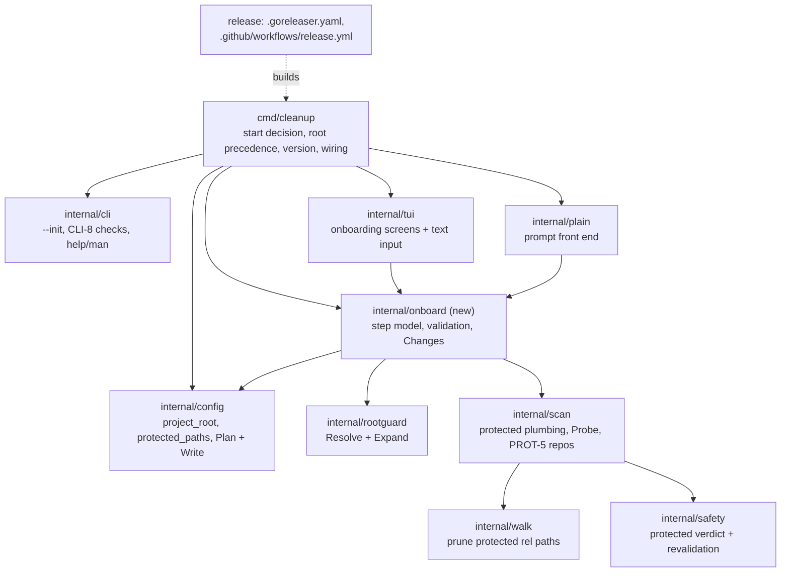
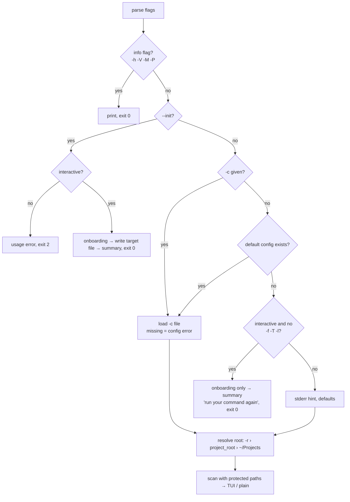
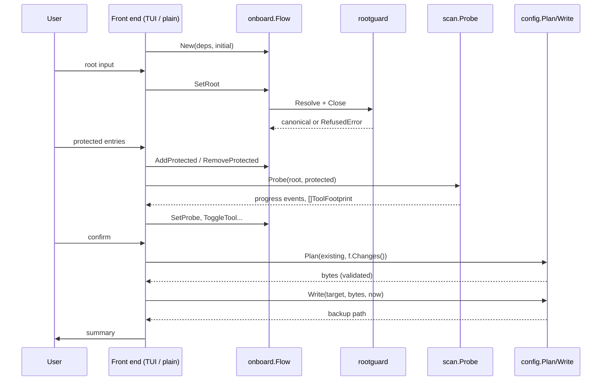
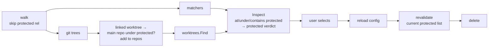

# cleanup v0.0.1: installation and first-run onboarding — Design

**Author**: John Fricker.
**Derived from**: [SPEC.md](SPEC.md) (approved 2026-11-20).
**Last updated**: 2026-11-21.
**Status**: Approved.
**Approved by**: John Fricker (2026-11-21).

Builds on the [v1 design](archive/2026-11-19-cleanup-v1-a-safe-clean-go-rebuild-of-the-gleanup-prototype/TECH-DESIGN.md)
and [ARCHITECTURE.md](ARCHITECTURE.md). Requirement IDs refer to SPEC.md.

## Design principles

1. **One onboarding model, two front ends.** The step logic, validation and the
   resulting config change live in one pure package; the TUI and plain prompts only
   render it and feed it input (ONB-1).
2. **Reuse, don't re-derive.** Step 1 validates with `rootguard.Resolve`; step 3 runs
   the real scan pipeline restricted to retired tools, so its ages and sizes are the
   inspector's own (AC-T3).
3. **Protection is enforced three times.** Walk pruning (performance and dry-run
   output), inspection (`protected(protected path)` verdict) and revalidation against
   a freshly reloaded config at delete time (PROT-4, PROT-6). Only the last two are
   safety-relevant.
4. **The removal invariant holds.** No new `os.Remove*` outside `internal/safety`
   (NFR-4); config writing is designed so it never needs to remove anything.
5. **Pure decisions, thin I/O.** First-run triggering, root precedence, version
   resolution and the config-diff computation are pure functions with table tests;
   `cmd/cleanup` only wires them to the terminal and filesystem.

## Affected components



### Module and release (INST-1…7)

- `go.mod` becomes `module github.com/jfricker/cleanup`; every import
  `cleanup/internal/...` becomes `github.com/jfricker/cleanup/internal/...`. Done as
  one mechanical change (`go mod edit -module` plus a literal import rewrite), with no
  other edits in the same commit so it reviews as a pure rename.
- No package imports `"C"` today; a test (`TestAC_I2`) scans non-test sources for
  `import "C"` so INST-2 can't regress.
- `.goreleaser.yaml` (schema v2):
  - `before.hooks`: generate the man page with the release version:
    `go run -ldflags "-X main.version={{ .Tag }}" ./cmd/cleanup -M > dist-extra/cleanup.1`.
  - one `builds` entry: `main: ./cmd/cleanup`, `env: [CGO_ENABLED=0]`,
    `goos: [darwin, linux]`, `goarch: [amd64, arm64]`,
    `ldflags: -s -w -X main.version={{ .Tag }}` (the tag, so output is `v0.0.1`, not
    GoReleaser's `{{ .Version }}` which strips the `v`), `flags: -trimpath`.
  - `archives`: `tar.gz`, name `cleanup_{{ .Version }}_{{ .Os }}_{{ .Arch }}`,
    `files: [README.md, dist-extra/cleanup.1]` (stored flat as `cleanup.1`).
  - `checksum`: `checksums.txt`, sha256. No changelog automation, no signing.
- `.github/workflows/release.yml`: `on: push: tags: ['v*']`;
  `permissions: contents: write`; steps: checkout (`fetch-depth: 0`),
  `actions/setup-go` with `go-version-file: go.mod`, `make check` (gate, INST-6),
  `goreleaser/goreleaser-action` with `args: release --clean`. Third-party actions are
  pinned by full commit SHA.
- Makefile: unchanged apart from the module path (if referenced); no install target
  (INST-3, checked by `TestAC_I3` reading the Makefile for those target names).

### Version (VER-1…3)

`cmd/cleanup/version.go`:

```go
var version string // set by -ldflags "-X main.version=v0.0.1"

func resolveVersion(ldflag string, bi *debug.BuildInfo, ok bool) string
```

Precedence: `ldflag` if non-empty; else `bi.Main.Version` if it matches
`^v\d+\.\d+\.\d+(\+dirty)?$` (a tag, possibly from a dirty tree); else `dev`.
Pseudo-versions (`v0.0.0-20261121…-hash`) and `(devel)` map to `dev`. `--version`,
help and `cli.Man` all receive the resolved string. Verified behaviour of
`debug.ReadBuildInfo` is in Verified facts.

### `internal/cli` (CLI-7…11)

- `Options.Init bool`; flag def `{"init", "", gInfo, "", "Run first-time setup (project root, protected directories, retired tools), then exit"}`.
  The flag table already drives help and man, so both goldens pick it up (AC-N9).
- `Parse` records which flags were set (`fs.Visit`). If `Init` is set and any flag
  other than `init`, `config`, `root`, `no-tui` was set, or a positional root is
  combined with `-r`, it returns `usagef("--init cannot be combined with --%s", name)`.
  A positional root with `--init` is treated like `-r` (CLI-10).
- The `-r` help text changes from "default ~/Projects" to
  "default: project_root from config, else ~/Projects" (CLI-11).

### `internal/config` (PROOT-4, PROT-3, CFGW-1…6, DOC-5)

Schema:

```go
type rawFile struct {
    Version        *int      `toml:"version"`
    ProjectRoot    *string   `toml:"project_root"`
    ProtectedPaths *[]string `toml:"protected_paths"`
    // existing tables unchanged
}

type Config struct {
    ProjectRoot    string   // tilde-expanded absolute path, "" when unset
    ProtectedPaths []string // cleaned, slash-separated, root-relative, sorted, unique
    // existing fields unchanged
}
```

- Both fields are top-level keys, so they must appear before the first table in the
  TOML file; the encoder already emits scalars first.
- Validation (in `validate`, reported as `LoadError` with line via `locate`):
  `project_root`: non-empty; after `~`/`~/` expansion with the password-database home
  (ROOT-2), must be absolute. Existence and rootguard are run-time checks (PROOT-5),
  not load errors, so a moved root gives the PROOT-5 message rather than a config
  error.
  `protected_paths`: each entry non-empty, not `.`, not absolute, no `..` component
  after `path.Clean`, no backslash; duplicates and nested entries collapse to the
  outermost (no error). Because entries are lexically confined, "outside the root" can
  only arise through a symlink inside the root; that is harmless (pruning a name
  protects more, never less) and inspection uses canonical paths anyway.
- Merge: user scalars replace defaults; `protected_paths` replaces (defaults have
  none).
- `defaults.toml` gains commented examples for both keys (DOC-5); `--print-config`
  round-trip (CFG-7) is unaffected because comments aren't keys.

New `write.go`:

```go
// Changes are the managed values onboarding decided.
type Changes struct {
    ProjectRoot    string          // "~/Code" or absolute; "" = default
    ProtectedPaths []string
    Retired        map[string]bool // tool id -> marked retired
}

// Plan returns the bytes to write: existing (may be nil) with managed keys replaced
// per CFGW-1/2, validated with LoadBytes (CFGW-3).
func Plan(existing []byte, ch Changes) ([]byte, error)

// Write backs up an existing target (CFGW-4) and writes data atomically (CFGW-5).
// It returns the backup path ("" if there was no file).
func Write(path string, data []byte, now time.Time) (backup string, err error)
```

`Plan`:
1. Decode `existing` into `rawFile` (strict; an invalid existing file is an error, so
   `--init` on a broken file stops before onboarding with the load error and a hint to
   fix or move it).
2. Set `ProjectRoot` (nil when it equals the default `~/Projects`), `ProtectedPaths`
   (nil when empty).
3. For each configured tool: compute the merged default `retired` value. If
   `ch.Retired[id]` differs from the default, set `retired` on the user entry
   (creating `{id, retired}` if absent). If it equals the default, clear the user
   entry's `retired`; drop the entry if only `id` remains (CFGW-2). Other tool fields
   are untouched.
4. Encode with `toml.NewEncoder` (nil pointers are omitted — verified). `rawRule`
   gains `omitempty` on its non-pointer string and slice fields so carried-over
   category rules don't gain empty keys.
5. `LoadBytes(path, out)`; any error aborts with nothing written.

`Write` never deletes anything:
- `os.MkdirAll(dir, 0o700)`.
- Backup: read the current bytes; create `config.toml.bak-<YYYYMMDDTHHMMSS>` with
  `O_CREATE|O_EXCL|0600`, retrying `-2`, `-3`, … on `EEXIST`; write; fsync.
- Temp file: fixed name `.config.toml.new` in the same dir, opened
  `O_CREATE|O_TRUNC|O_WRONLY, 0600`; write; fsync; close; `os.Rename` onto the target;
  fsync the directory. If any step fails the temp file is left behind and is simply
  truncated and reused by the next `--init`. A fixed name (rather than
  `os.CreateTemp` plus cleanup) is what keeps NFR-4 intact.

### `internal/rootguard` (PROOT-2)

- New `Expand(p, home string) string`: `~` → home, `~/x` → home/x, anything else
  unchanged. Exported `Home() (string, error)` wraps the existing password-database
  lookup so config, onboarding and `cmd` agree on one home (ROOT-2).
- Validation reuses `Resolve(path, Options{})` then `Close()`; the `RefusedError`
  text is shown verbatim (PROOT-2, ROOT-5).

### `internal/walk` (PROT-4)

- `Options.Protected []string` (root-relative, slash). Stored as a set. In
  `walker.dir`, before dispatching an entry to visitors or descending, compute the
  child rel; if it is in the set, skip it entirely (no visitor sees it, no descent, no
  git-tree discovery). One map lookup per entry; protected entries are typically few.

### `internal/scan` (PROT-4, PROT-5, TOOL-1…7)

- `Options.Protected []string` passed to `walk.Options.Protected` and to
  `safety.Config.Protected`.
- **PROT-5 (worktrees of protected repos).** Today the provider only lists worktrees
  of repositories the walk found. With a protected subtree pruned, its repos are no
  longer found, so their linked worktrees elsewhere under the root would silently
  vanish from proposals. Fix: for each walked git tree that is a *linked worktree*
  (`.git` is a file), resolve its common dir with the existing
  `gitx` `rev-parse --git-common-dir` query; if the main repository lies at or under a
  protected path, add it to the `repos` list given to `worktrees.Find`. Worktrees that
  `Find` then returns under a protected path are turned into protected verdicts by
  inspection (below), so the protected repo's own in-place worktrees stay safe.
- `Probe` (new, read-only):

  ```go
  type ToolFootprint struct {
      Tool       config.Tool
      Items      int           // eligible + too-recent items
      TooRecent  int           // TOOL-3
      Size       int64
      Youngest   time.Duration // TOOL-2 age
  }

  func Probe(ctx context.Context, cfg *config.Config, root rootguard.Root,
      git *gitx.Runner, protected []string, emit func(Event)) ([]ToolFootprint, error)
  ```

  It calls `Run` with `Only: [retired]`, `Retired: cfg.ToolIDs()` (every tool, whatever
  its `retired` value), `Protected: protected`, worktrees off. It groups verdicts by
  `Candidate.Rule` (tool id): eligible verdicts and `skipped(fresh)` verdicts count as
  items (fresh ones also as `TooRecent`); verdicts skipped or protected for any other
  reason (tracked files, git state, inspection failure) are excluded because a real
  run could never clean them. Sorted by `Youngest` ascending (TOOL-2). The `emit`
  callback drives step 3's progress line (TOOL-7); cancellation is the scan's existing
  context handling (TOOL-6).
- Read-only: the scan pipeline never writes; git calls run with
  `GIT_OPTIONAL_LOCKS=0` already (verified), so `git status` doesn't refresh the index
  (AC-O9).

### `internal/safety` (PROT-6)

- `Config.Protected []string`; new `ReasonProtectedPath` ("protected path").
- `Inspect` adds a step right after the containment check: if the candidate's rel is
  equal to or under a protected path, or a protected path is under the candidate's
  rel, return `Protected(ReasonProtectedPath, <path>)`. `Reconcile` already propagates
  protected children to parents.
- `Deleter` gets the protected list for the *current* config:
  `NewDeleter(in, protected []string)`. `revalidate` applies the same two prefix checks
  to the target's rel before identity checks. `cmd/cleanup.execute` reloads the config
  file (same path, strict) immediately before deletion; if the reload fails, deletion
  aborts before any item with the load error (fail closed), and the run log is not
  opened. The reloaded `protected_paths` go to `NewDeleter`. Other reloaded values are
  ignored for this run.

### `internal/onboard` (new; ONB-1…5, PROOT-1…3, PROT-1…2, TOOL-2…5, CFGW-7)

Pure state machine shared by both front ends; no terminal I/O.

```go
type Deps struct {
    Home          string
    ResolveRoot   func(path string) (canonical string, err error) // rootguard
    Probe         func(ctx context.Context, root string, protected []string,
                       emit func(scan.Event)) ([]scan.ToolFootprint, error)
    PathWarning   string // "" when the executable's dir is on PATH (ONB-5)
}

type Initial struct { // from flags + existing config merged over defaults (ONB-2)
    Root      string
    Protected []string
    Retired   map[string]bool
}

type Flow struct { /* step, values, errors, probe results */ }

func New(d Deps, in Initial) *Flow
func (f *Flow) Step() Step                       // Root, Protected, Tools, Summary
func (f *Flow) SetRoot(input string) error       // PROOT-2; stays on step on error
func (f *Flow) AddProtected(input string) error  // PROT-1/2
func (f *Flow) RemoveProtected(rel string)
func (f *Flow) Next() / Back()
func (f *Flow) SetProbe([]scan.ToolFootprint)
func (f *Flow) ToggleTool(id string)
func (f *Flow) Changes() config.Changes          // PROOT-3 formatting (~/ under home)
```

- Root display/storage: canonical path from `ResolveRoot`; stored as `~/rel` when
  under `Home`, else absolute; omitted when equal to `~/Projects` (PROOT-3).
- Protected input: `~`/absolute paths under the root are converted to root-relative;
  existence and "is a directory" checked with `os.Stat` relative to the canonical
  root; nesting/duplicates rejected (PROT-2).
- Changing the root in step 1 after entering protected paths revalidates them against
  the new root and drops (with a visible message) those that no longer exist under it.
- The summary text (CFGW-7, including the "comments not preserved" line and, for an
  auto-triggered run, "run your command again") is produced here so both front ends
  print identical text.

### `internal/tui` (ONB-1, ONB-3, TOOL-7, NFR-10)

- New `onboard.go`: a second Bubble Tea model (`OnboardModel`) wrapping
  `onboard.Flow`, plus `RunOnboard(deps) (code int, err error)`. Same split as the
  existing app: a pure update function returning effects, a thin `tea.Model` adapter.
- Screens: root (single-line input pre-filled), protected (list + input line, `a` add,
  `d` remove), tools (checkbox list with name, count, size, age, note; space toggles),
  summary. Footer key hints on every screen; `Esc`/`Ctrl+C` cancel (exit 130),
  `Shift+Tab`/`b` back, `Enter` next.
- Text input is a small hand-rolled line editor in the pure model (insert, backspace,
  left/right, home/end, Ctrl+U, paste as text) rather than a new dependency.
- The probe runs as a `tea.Cmd`; progress events update a spinner line; the screen
  stays responsive (NFR-2). Colours come from the existing palette and respect
  `NO_COLOR`; the layout fits 80×24 (NFR-10).
- `RunOnboard` returns `errTUIUnavailable` if the program fails before its first
  render; `cmd/cleanup` then falls back to plain prompts (ONB-1).

### `internal/plain` (ONB-1, ONB-3, TRIG-3, NFR-10)

- New `onboard.go`: `Onboard(ctx, r io.Reader, w io.Writer, f *onboard.Flow) (int, error)`.
  One question per line, defaults in brackets, `?` prints help, `b` goes back, empty
  answer accepts the default. Tools are listed numbered; the user enters numbers to
  toggle, empty to continue.
- Reads happen in a goroutine feeding a channel so SIGINT (context) and EOF both
  cancel promptly (exit 130, nothing written).
- No ANSI sequences; output is golden-testable.

### `cmd/cleanup` (TRIG-1…5, CLI-9…11, PROOT-5, PROT-7, ONB-5)

- `run(args, env)` where `env` bundles `Stdin io.Reader`, `Stdout`, `Stderr`,
  `Interactive func() bool`, `Getenv`, `Executable`, `Now`, so tests can drive
  interactive paths through pipes (SPEC AC preamble). `main` passes the real values;
  `Interactive` is `isTTY(os.Stdin) && isTTY(os.Stdout)`.
- `defaultConfigPath()` returns `(path string, exists bool)` instead of `""` when
  missing.
- Pure start decision:

  ```go
  type start int // startRun, startOnboard, startOnboardOnly, startHint
  func decideStart(o cli.Options, defaultExists, interactive bool) start
  ```

  `--init` → `startOnboard` (or a CLI-9 usage error when not interactive);
  TRIG-1 conditions → `startOnboardOnly` (TRIG-2); missing default without `-c` and
  not an info flag → `startHint` (one stderr line, then a normal run with defaults);
  otherwise `startRun`. Info flags (`-h`, `-V`, `-M`, `-P`) still return before any
  of this, as today.
- Root precedence (CLI-11, PROOT-5):
  `resolveRoot(opts, cfg, home) (path string, source rootSource, err error)` with
  sources `flag`, `config`, `default`. A `config` root that fails `os.Stat` or
  rootguard returns the PROOT-5 message
  (`project_root "<p>" from <file>: <reason>; run "cleanup --init" or pass -r DIR`).
- Onboarding wiring: load the target config (if present) → build `onboard.Initial`
  (with `-r` pre-fill, CLI-10) → `onboard.Deps` (`ResolveRoot` = rootguard,
  `Probe` = `scan.Probe` with a new git runner and a context cancelled by the existing
  signal handler, `PathWarning` from `pathWarning(executable, PATH)`) → choose front
  end (`-T` or `TERM=dumb` → plain, else TUI with plain fallback) → on confirm
  `config.Plan` + `config.Write` → print the summary → exit 0.
- `pathWarning` resolves `os.Executable()` with `EvalSymlinks`, compares its dir
  against each `PATH` entry (also `EvalSymlinks`-resolved), and returns the warning
  text with the export line for the user's `$SHELL` (zsh/bash/fish variants).
- `-l` (`listCategories`) gains a header: `Root: <path> (from flag|config|default)`
  and `Protected: <rel> ok|missing` lines (PROT-7).
- `execute` reloads config before deletion (see safety) and passes the protected list
  through.

## Data flow / interfaces

### Start-up



### Onboarding



### Protection at run time



## Requirement traceability

| Requirement | Component(s) |
|---|---|
| INST-1…3 | `go.mod`, imports, Makefile, `TestAC_I1–I3` |
| INST-4…7 | `.goreleaser.yaml`, `release.yml`, operator tag |
| VER-1…3 | `cmd/cleanup/version.go`, `cli.Man` |
| CLI-7…11 | `internal/cli`, `cmd/cleanup.resolveRoot` |
| TRIG-1…5 | `cmd/cleanup.decideStart`, `env.Interactive` |
| ONB-1…5 | `internal/onboard`, `internal/tui/onboard.go`, `internal/plain/onboard.go`, `cmd/cleanup.pathWarning` |
| PROOT-1…5 | `onboard.Flow.SetRoot`, `rootguard.Expand/Resolve`, `config.validate`, `cmd/cleanup.resolveRoot` |
| PROT-1…7 | `onboard.Flow`, `config.validate`, `walk.Options.Protected`, `scan` (PROT-5), `safety.Inspect`/`revalidate`, `cmd/cleanup.execute`, `listCategories` |
| TOOL-1…7 | `scan.Probe`, onboarding screens |
| CFGW-1…7 | `config.Plan`, `config.Write`, `onboard` summary |
| DOC-3…5 | `README.md`, `cli` help/man, `defaults.toml` |
| NFR-8…11 | `scan.Probe` benchmark, no new network code, TUI/plain onboarding, gate |

## Alternatives considered

| Decision | Chosen | Rejected and why |
|---|---|---|
| Init entry point | `--init` flag | `init` subcommand: collides with the positional root argument (operator decision). |
| Rewriting config | Decode → set managed keys → re-encode, validate | Format-preserving TOML editing: keeps comments but needs a new library or a hand-written TOML editor; the timestamped backup covers comment loss (INTENT decision). |
| Step 3 probe | Run the real scan restricted to retired tools | A lightweight dedicated walker: faster, but would compute age and eligibility differently from the inspector, so "won't be cleaned yet" could be wrong (AC-T3). |
| Protected-path enforcement | Walk + inspect + revalidate with reloaded config | Walk-only: misses worktrees found via git and a config changed mid-session (PROT-6). Inspect-only: still walks protected subtrees, wasting time and showing them in progress. |
| Delete-time config | Reload the config file just before deletion | Watching the file during the session: more moving parts for the same guarantee. |
| PROT-5 | Resolve main repos of linked worktrees and include protected ones | Dropping PROT-5 (simpler, but a protected repo's stale worktrees elsewhere would never be offered, contradicting the INTENT decision). |
| Atomic write temp file | Fixed `.config.toml.new`, truncated and reused | `os.CreateTemp` + cleanup on failure: needs `os.Remove` outside `internal/safety`, breaking NFR-4. A safety-owned removal helper would widen the one package allowed to delete. |
| Text input | Hand-rolled line editor in the pure TUI model | `bubbles/v2` textinput: adds a dependency and its own update loop for a single-line field. |
| Release build | GoReleaser in Actions | Hand-written build matrix (operator decision). |
| Version source | ldflags › tagged build info › `dev` | ldflags only: `go install …@v0.0.1` would print `dev`. |
| Onboarding front ends | One pure `onboard.Flow`, two renderers | Separate implementations per front end: duplicated validation, drift between modes. |

## Trade-offs and risks

- **Module rename touches every Go file.** Mechanical and isolated in its own commit;
  `make check` proves it. Any open branches will conflict; there are none today.
- **Probe cost.** Step 3 runs the full inspection for every footprint, including git
  checks when a footprint sits inside a git tree. Footprints are usually few, and the
  walk dominates (NFR-8 compares against the NFR-1 budget). If a root has many
  footprints inside large repos, step 3 could take seconds; progress is shown and
  Ctrl+C works.
- **Excluding non-cleanable items from step 3** means a tool whose only leftovers are
  tracked files is hidden. That matches "show what a real run could clean" but may
  surprise a user who knows the files exist.
- **Config reload before deletion** can fail (user broke the file mid-session). The
  run then deletes nothing and says why — correct, but a user may lose their
  selection. Acceptable: fail closed.
- **Fixed temp filename**: two concurrent `--init` runs on the same file could
  interleave writes to `.config.toml.new`. The rename is still atomic, and the result
  is one of the two complete files; concurrent onboarding is not a supported workflow.
- **TUI start failure detection** relies on `tea.Program.Run` erroring before the
  first frame. If it fails later, the user sees an error and can re-run with `-T`.
- **GoReleaser config is untested until the first tag.** Mitigation: `goreleaser check`
  and `goreleaser release --snapshot --clean` locally before tagging (AC-I4/I5,
  manual).
- **PATH check false positives** for `go run` binaries (temp dirs) during
  development. It's a non-blocking warning.
- **Gatekeeper**: unsigned release binaries are quarantined on macOS; documented
  workaround only (out of scope to sign).

## Verified facts

Verified 2026-11-20 (go 1.27.2, darwin/arm64).

- `debug.ReadBuildInfo().Main.Version` is `(devel)` under `go run`; a pseudo-version
  (`v0.0.0-20261121001240-9f1cf8802a37`) for `go build` in a git checkout with no tag;
  `v0.0.1+dirty` at tag `v0.0.1` with untracked files present (so `v0.0.1` on a clean
  tree). `go install path@v0.0.1` sets the module version from the proxy.
- `toml.NewEncoder(...).Encode(&rawFile{...})` omits nil pointer fields, emits scalars
  before tables, and the output of re-encoding a decoded user file loads with
  `LoadBytes`.
- The hardened git runner already sets `GIT_OPTIONAL_LOCKS=0`
  (`internal/gitx/runner.go` `scrubEnv`), so `git status` during the probe never
  rewrites the index.
- `worktrees.Find` only lists worktrees of repositories found by the walk; a linked
  worktree whose main repo isn't walked is never proposed today (basis for the PROT-5
  design).
- `safety.Verdict` already carries `Size` and `Age`; a too-recent item is
  `Skipped` with `ReasonFresh`.

## Open questions

None. Resolved by the operator (2026-11-21):

1. **Fixed temp filename (`.config.toml.new`)** instead of a random temp file plus
   cleanup, keeping NFR-4 strict. Accepted.
2. **Step 3 excludes items a real run could never clean** (tracked files, git state,
   inspection failure). Accepted.
3. **`v0.0.1+dirty`** is shown as-is when built from a dirty tree at a tag, not mapped
   to `dev`. Accepted.
