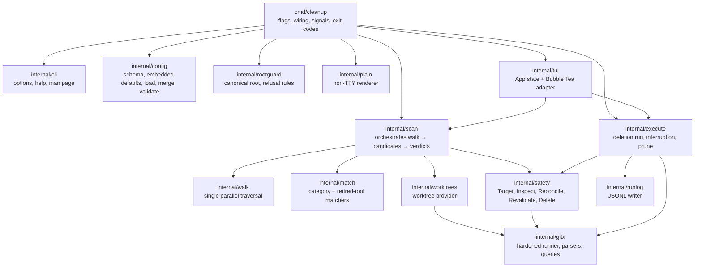
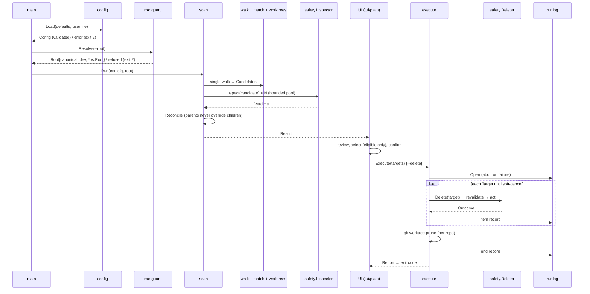

# cleanup v1: a safe, clean Go rebuild of the gleanup prototype — Design

**Author**: John Fricker.
**Derived from**: [SPEC.md](SPEC.md) (approved 2026-11-19).
**Last updated**: 2026-11-19.
**Status**: Approved.
**Approved by**: John Fricker (2026-11-19).

This is the technical design for the approved spec. Requirement IDs (CLI-1, GIT-2, …)
refer to SPEC.md. File-by-file sequencing belongs in PLAN.md.

## Design principles

1. **One safety package.** Everything that decides or performs a deletion lives in
   `internal/safety`: the verified-target type, inspection, reconciliation,
   revalidation and deletion. No other package can create a deletable target or call
   `os.Remove*` (NFR-4). Reviewers read one package to audit safety.
2. **Matchers propose, safety decides.** Category rules, retired tools and the worktree
   provider produce plain `Candidate` values with no power to delete.
3. **Fail closed by type.** Inspection returns a `Verdict`. Only the `eligible*` kinds
   hold a `Target`, and a `Target` can only be built inside `safety`.
4. **All filesystem mutation goes through `os.Root`** opened on the canonical scan root,
   so a path can't escape the root even if the tree changes between scan and delete.
5. **Pure state, thin glue.** The TUI keeps gleanup's good pattern: a pure `App` state
   machine driven by messages (testable without a terminal), with a small Bubble Tea
   adapter.

## Affected components

Greenfield Go module at `~/Projects/cleanup` (module path `cleanup`). No existing code is modified; gleanup is reference only.



### `cmd/cleanup`

Parses flags (via `internal/cli`), loads config, validates the root, picks TUI or plain
mode, installs signal handling, maps outcomes to exit codes (CLI-6). Owns the single
`context.Context` for the run.

### `internal/cli` (CLI-1…6, DOC-1)

- `Options` struct, `Parse(args) (Options, error)` on `spf13/pflag`.
- `-n`/`-d` implemented as one `mode` value with last-flag-wins (gleanup's `modeFlag`
  pattern, which works).
- `-y` is registered as a hidden flag whose setter returns the CLI-2 error.
- Flag definitions are a table (name, short, group, help, unsafe) used for `--help`
  grouping (CLI-3), the man page (DOC-1) and golden tests, so they can't drift.
- ID validation for `--only/--exclude/--retired` runs after config load (CLI-4).

### `internal/config` (CFG-1…7, CAT-1…2, RET-1…3)

- `defaults.toml` embedded with `//go:embed`; contains `version = 1`, gleanup's
  categories, the worktree provider and the retired-tool list with `retired = false`.
- **Raw vs validated types.** TOML decodes into `raw*` structs (strings, pointers for
  "unset"), then `validate()` converts them to `Config` with typed enums:
  `type Kind uint8` (`KindDir`, `KindFile`), `type Strategy uint8` (`StrategyRemove`,
  `StrategyEmptyContents`), `type OptIn uint8` (`OptInNone`, `OptInVenvs`,
  `OptInModules`). Zero values are invalid sentinels, so a missed conversion fails
  validation instead of defaulting to whole-folder removal.
- **Load order.** Decode defaults → decode user file with `toml.DecodeFile` → reject
  `md.Undecoded()` keys (CFG-3) → check `version` (CFG-2) → merge (CFG-1) → validate
  patterns (CFG-5) → force `.git` into `never_touch` (CFG-6).
- **Error positions.** BurntSushi/toml's `MetaData` has key paths but no line numbers for
  undecoded keys. A small helper re-scans the user file's text for the key's table header
  and key to report `file:line` (CFG-3, AC-R5). Suggestions use Levenshtein distance over
  the valid keys for that table.
- `--print-config` writes the embedded file verbatim (CFG-7 round-trip test).

### `internal/rootguard` (ROOT-1…5)

`Resolve(path string) (Root, error)`. `Root` holds the canonical path, its device ID and
an open `*os.Root`. Home comes from `user.Current().HomeDir`, canonicalised too
(macOS `/Users` vs `/private/...` symlinks). Refusal rules are a table of
`{path, match: exact|subtree, reason}` built at start. Exact-ancestor check: every parent
of home is refused. Linux rules are selected by `runtime.GOOS`.

### `internal/walk` (WALK-1…5)

- A parallel directory walker: a worker pool (size `GOMAXPROCS`) pulls directory jobs
  from a queue, calls `os.ReadDir` once per directory, and uses `DirEntry.Type()` (from
  `getdirentries`, no extra stat) so symlinks are recognised without following (WALK-2).
- For each directory it builds a `DirView{Path, Rel, Entries, NameSet, AncestorMarkers,
  EnclosingGitTree}` and hands it to every registered `Visitor` (category matchers,
  retired-tool matchers, git discovery).
- Visitors return a `Decision` per child: `Descend`, `Candidate(c)` (record, don't
  descend), or `Skip`. The walker descends only if every visitor says `Descend`
  (WALK-3).
- `AncestorMarkers` is an immutable persistent set passed down the tree, so
  `require_ancestor_markers` needs no upward stat. `require_sibling_markers` uses the
  parent's `NameSet`. `require_self_markers` reads the candidate dir's top level; that
  read is reused later by the subtree scan, so the directory is still read once.
- Device check: `Lstat().Sys().(*syscall.Stat_t).Dev` must equal the root's (WALK-4).
- Walk errors go to an error list with the path; a directory that couldn't be read is
  remembered so candidates containing it are marked (WALK-5).
- A debug counter of `ReadDir` calls per path backs AC-W1.

### `internal/match` (CAT-1…3, RET-1…4)

- `CategoryMatcher` compiles each category's rules into fast lookups: a `map[string]rule`
  for names and precompiled globs (`path.Match`, validated at load). Per-category `prune`
  lists suppress descent for that category only: the walker still descends if another
  visitor wants to. That's the semantics gleanup had, now expressed as per-visitor
  decisions.
- Dedup (CAT-3) happens in `scan`, keyed by canonical path, keeping the lowest
  `sort_order`.
- `RetiredMatcher` matches `dirs` and `files` (names and globs) of retired tools only.
  It never inspects PATH or app paths (RET-1).

### `internal/gitx` (GIT-1, GIT-2 primitives, WT-1, WT-4, WT-5)

- **Runner.** `type Runner struct{ bin string; env []string; timeout time.Duration;
  sem chan struct{} }`.
  - `bin` is resolved once, from the first existing of `/usr/bin/git`,
    `/opt/homebrew/bin/git`, `/usr/local/bin/git`, then `exec.LookPath`. The resolved path
    is shown in `--list-categories`.
  - `env` is `os.Environ()` minus every `GIT_*` variable, plus `GIT_CONFIG_NOSYSTEM=1`,
    `GIT_TERMINAL_PROMPT=0`, `GIT_OPTIONAL_LOCKS=0`, `LC_ALL=C`.
  - Every call uses `exec.CommandContext` with a per-call timeout, `cmd.WaitDelay`, and
    `Setpgid` so a timeout kills the whole process group. Concurrency is capped at 8
    (NFR-3).
  - Base args: `-c core.fsmonitor=false -c core.hooksPath=/dev/null
    -c core.untrackedCache=false -c protocol.allow=never`.
- **Filter neutralisation (new, beyond spec GIT-1).** Before running `status` in a tree,
  the runner reads `git config --includes --name-only --get-regexp '^filter\.'` (reading
  config runs nothing) and adds `-c filter.<name>.clean= -c filter.<name>.smudge=
  -c filter.<name>.process= -c filter.<name>.required=false` for each driver. Verified:
  without this, `git status` runs a repo-local `clean` command. Side effect: LFS files
  whose stat info is stale may read as modified. That makes the tree skip, which is the
  safe direction.
- **Submodules.** Parent `status` runs with `--ignore-submodules=all`. Each submodule is
  inspected as its own git tree (GIT-4), so the filter list of each repo is used for that
  repo.
- **Queries** (each returns `(T, error)`; callers turn any error into a skip):

  | Function | Command | Used for |
  |---|---|---|
  | `Dirs(tree)` | `rev-parse --absolute-git-dir --git-common-dir --is-inside-work-tree` | linked vs full clone, lock files |
  | `Status(tree)` | `status --porcelain=v2 -z --branch --untracked-files=all --ignored=matching --ignore-submodules=all` | GIT-2 1,2; GIT-3 ignored; branch, upstream, ahead |
  | `HasStash(tree)` | `rev-parse --verify --quiet refs/stash` (exit 1 = none, other = error); count via `rev-list --walk-reflogs --count refs/stash` | GIT-2 3 (full clones), GIT-3 note (linked) |
  | `Reachable(tree)` | `for-each-ref --contains HEAD --format=%(refname)` minus `refs/stash` | GIT-2 4, only when detached |
  | `LocalOnlyCommits(tree)` | `rev-list --count --branches --tags --not --remotes` | GIT-2 6 (full clones) |
  | `BranchUnpushed(tree)` | `# branch.ab` from status, else `rev-list --count HEAD --not --remotes` | GIT-3 note |
  | `Tracked(repo, paths)` | `ls-files -z -- <paths…>`, batched by repo, chunked under ARG_MAX | INSP-4 |
  | `Worktrees(repo)` | `worktree list --porcelain -z` | WT-1, lock state |
  | `WorktreeRemove(repo, path, force)` | `worktree remove [--force] <path>` | WT-4 |
  | `Prune(repo)` | `worktree prune` | WT-5 |

- **Lock state** (GIT-2 5) is read from the filesystem, not git: `index.lock`,
  `MERGE_HEAD`, `CHERRY_PICK_HEAD`, `REVERT_HEAD`, `BISECT_LOG`, `rebase-merge/`,
  `rebase-apply/` in the git dir, and `locked` in the worktree list.
- **Parsers** are pure functions over `[]byte`, split on NUL, with fuzz tests (AC-G7).
  Type-2 (rename) records consume an extra NUL field.

### `internal/worktrees` (WT-1…3)

For each repo the walk discovered (a dir with a `.git` *directory*), call
`gitx.Worktrees` once. Linked worktrees are canonicalised; in-root ones become
`Candidate{Kind: CandWorktree, Repo, Path}`, out-of-root ones become
`protected(outside root)` records for `--show-skipped` (WT-2). Prunable entries become a
`CandPrune{Repo}` action that is applied, never deleted. Age uses
`providers.worktrees.age_days` or `--age` (fixes #9).

### `internal/safety` (INSP-1…7, GIT-2…5, AGE-1…2, DEL-1…6)

```go
// Target is a verified deletion target. Its fields are unexported and it has no
// exported constructor; the zero value is rejected by Delete.
type Target struct{ v *verified }

type verified struct {
    rel      string      // path relative to the root
    abs      string      // canonical absolute path (display, log)
    dev, ino uint64      // identity at inspection time
    kind     TargetKind  // Remove, EmptyContents, Worktree
    repo     string      // for Worktree
    gitTrees []gitSnapshot // trees to re-check at revalidation
    force    bool        // worktree remove --force (only with -D)
}

type Verdict struct {
    Candidate match.Candidate
    Kind      VerdictKind // Eligible, EligibleWithNotes, Skipped, Protected
    Reasons   []Reason    // typed codes + detail strings, never free text alone
    Notes     []Note
    Size      int64
    Age       time.Duration
    target    Target      // set only for Eligible*
}

func (v Verdict) Target() (Target, bool)

type Inspector struct { root rootguard.Root; git *gitx.Runner; cfg InspectConfig }
func (in *Inspector) Inspect(ctx context.Context, c match.Candidate) Verdict
func Reconcile(vs []Verdict) []Verdict   // INSP-7
func (d *Deleter) Delete(ctx context.Context, t Target) Outcome
```

**Inspect pipeline**, short-circuiting on the first skip or protect:

1. Containment: `filepath.Rel(root, canonical)` must not start with `..`, and the path
   must `Lstat` via `os.Root` as a non-symlink (INSP-3, WALK-2). Record dev/ino.
2. Subtree scan, one pass over the candidate's subtree through `os.Root`: total size,
   nested git trees (dirs containing `.git`), unreadable dirs, and the deep max mtime
   when AGE-2 applies (computed in the same pass; cost only paid when needed). Skips
   symlinks, `never_touch` and `.git/objects`.
3. Tracked check (INSP-4): if the candidate has an enclosing git tree from the walk
   (`DirView.EnclosingGitTree`) and isn't itself that tree, batch `Tracked`. Batching
   is done by `scan` before inspection: one `ls-files` per repo for all its candidates,
   with results passed in.
4. Git checks for the candidate if it is a git tree, and for each nested git tree
   (INSP-5, GIT-2, GIT-4). Any error → `skipped(inspection failed)` (INSP-2).
5. Age (INSP-6): AGE-1 by default. AGE-2 when the item is a retired-tool path outside
   any git tree, or a git tree that only passes because of `-D`.
6. Notes (GIT-3, GIT-5): ignored files (first 20 + count), unpushed linked-worktree
   branch, `-D`.
7. Build `Target` with dev/ino and a `gitSnapshot` per checked tree (HEAD oid, status
   digest, stash presence).

**Reconcile (INSP-7)** sorts verdicts by path and does one pass with a stack. Any
verdict whose path is a strict ancestor of a skipped or protected verdict is downgraded
to `skipped(contains skipped item: <first>)`, and its `target` is cleared. This happens
after all inspection, so it can't be bypassed by cleaner order (the R1 mechanism).
Eligible descendants stay eligible.

**Selection rule.** Selecting a group or parent in the UI expands to the set of
eligible leaf `Target`s. A skipped verdict has no target, so it can't be passed to
`Delete`.

**Revalidate + Delete (DEL-1…3).** `Delete(t)`:
1. Rejects the zero `Target`.
2. `root.Lstat(t.rel)`: must exist, not be a symlink, and have the same dev/ino. The
   canonical path must be unchanged (re-`EvalSymlinks` on the parent).
3. For each `gitSnapshot`, re-run `Status`, `HasStash` and `rev-parse HEAD`. Any change
   → `skipped(changed since scan)`.
4. Act:
   - Remove: `root.RemoveAll(rel)`.
   - EmptyContents: `root.OpenRoot(rel)`, then `RemoveAll` on each child.
   - Worktree: `gitx.WorktreeRemove` without `--force` unless `t.force`; git's refusal
     → `failed(git refused)` with no fallback (WT-4).
5. Returns `Outcome{Deleted|Skipped|Failed|Partial, BytesFreed, Err}`.

`os.Root` was verified to refuse a parent component swapped for an outside symlink, and
to remove only the link for a symlink leaf (#13, AC-C2, AC-C4).

### `internal/scan`

```go
type Event struct{ Kind EventKind; Cleaner string; Path string; Counts Counts; Err error }
type Result struct{ Verdicts []safety.Verdict; WalkErrors []walk.Error; PruneRepos []string }
func Run(ctx context.Context, cfg config.Config, root rootguard.Root, opts Options,
         emit func(Event)) (Result, error)
```

Pipeline: walk (emitting progress) → candidates (deduped, CAT-3) → per-repo batched
`Tracked` → bounded inspector pool → `Reconcile` → sorted `Result`. Cancelling `ctx`
stops the walk and drains workers. `emit` never blocks: it uses a buffered channel with
latest-value coalescing for progress, which fixes gleanup's producer leak (TUI-5).

### `internal/execute` (DEL-4…6, WT-5, LOG-1…3)

```go
type Run struct{ Deleter *safety.Deleter; Log *runlog.Writer; Git *gitx.Runner }
func (r Run) Execute(ctx, soft context.Context, targets []safety.Target,
                     emit func(DeleteEvent)) Report
```

- Two contexts implement DEL-5. `soft` is cancelled by the first SIGINT/SIGTERM: the loop
  checks it between items. `ctx` is cancelled by the second signal and is passed into the
  current deletion. `os.Root.RemoveAll` can't be interrupted, so the hard cancel makes
  the worker abandon the wait and mark the item `partial` after re-`Lstat`.
- Items run sequentially, ordered by worktrees first, then deepest path first. Each
  failure is recorded once (DEL-4).
- After the loop, whether it finished normally or was interrupted, `Prune` runs once per
  repo that had worktree removals or gone entries (WT-5).
- `Report` lists deleted, skipped (changed since scan), failed and not-attempted items
  with bytes. Plain and TUI render the same `Report` (DEL-6).

### `internal/runlog` (LOG-1…3)

`Open(stateDir) (*Writer, error)`: `$XDG_STATE_HOME/cleanup` or
`~/.local/state/cleanup`, `MkdirAll 0700`, open `runs.jsonl` with
`O_APPEND|O_CREATE|O_WRONLY`, mode 0600. It is opened before the first deletion, and a
failure aborts (LOG-2). Records are `{"type":"start|item|end","run":<ULID-like id>,
"ts":RFC3339,"root","path","cleaner","bytes","outcome","error"}`. Each record is one
`Write` plus `Sync` on `end`. The log writes plain `os` calls because it lives outside
the root. It is the one sanctioned exception to "mutation through `os.Root`", and it is
create/append only.

### `internal/plain` (PLAIN-1…3)

Renders `scan.Result` and `execute.Report` to an `io.Writer`, sorted, with no ANSI when
the writer isn't a TTY or `NO_COLOR` is set. In delete mode it prints the warnings and
notes block before executing. The failures section appears only in the final summary.

### `internal/tui` (TUI-1…6)

- `App`: pure state with `Phase` (Scanning, Review, Confirm, Deleting, Done), tree
  model, selection set (verdict IDs; selectable only if `Target()` is ok, TUI-3/AC-T2),
  filter string, grouping, detail focus. `Update(msg) (App, []Effect)` returns effects
  (start delete, quit) instead of doing I/O, so every phase is unit-testable (AC-T1).
- Adapter: Bubble Tea `Model` that maps `tea.Msg` to `App` messages and `Effect`s to
  `tea.Cmd`s. Scan and delete events arrive via channels read by `tea.Cmd`s, as in
  gleanup, but the channels are closed on context cancel. `goleak` checks this in tests.
- Ctrl+C mapping:
  - Scanning: cancel the scan and quit.
  - Review or Confirm: quit with no deletions.
  - Deleting: the first press calls the `soft` cancel and shows "finishing current
    item…"; the second calls the hard cancel. The TUI never prints "cancelled, nothing
    deleted" during or after the Deleting phase (fixes #7).
- Confirm modal: focus defaults to Cancel; it lists warnings, notes, count and size
  (TUI-4).
- Layout: two panes (tree + detail) at ≥100 columns, one pane with the detail on toggle
  below that, minimum 80×24 (TUI-6). The palette is defined once with light/dark
  variants. State is also shown by glyphs (`✓ ✗ ⊘ !`), never colour alone.

## Data flow / interfaces



Concurrency summary:
- **Walk:** `GOMAXPROCS` workers.
- **Inspection:** `GOMAXPROCS` workers.
- **Git:** at most 8 concurrent calls, shared by inspection and worktree listing.
- **Deletion:** sequential, for predictable interruption and logging.

## Requirement traceability

| Area | Requirements | Component |
|---|---|---|
| CLI | CLI-1…6, DOC-1 | `cli`, `cmd/cleanup` |
| Root | ROOT-1…5 | `rootguard` |
| Config | CFG-1…7, RET-2, RET-3 | `config` |
| Walk | WALK-1…5 | `walk` |
| Categories, retired | CAT-1…3, RET-1, RET-4 | `match`, `scan` |
| Worktrees | WT-1…5 | `worktrees`, `gitx`, `execute` |
| Inspection, git, age | INSP-1…7, GIT-1…5, AGE-1…2 | `safety`, `gitx` |
| Deletion | DEL-1…6 | `safety`, `execute` |
| Run log | LOG-1…3 | `runlog`, `execute` |
| UI | TUI-1…6, PLAIN-1…3 | `tui`, `plain` |
| Engineering | NFR-4, NFR-6, DOC-2 | `Makefile`, `safety_test` source scan, `go.mod` `tool` directives |

## Tooling and repo layout

- Go 1.27 (pinned in `go.mod`). Dependencies: `charmbracelet/bubbletea`, `lipgloss`,
  `bubbles` (text input for the filter), `BurntSushi/toml`, `spf13/pflag`; tests:
  `go.uber.org/goleak`. Exact major versions are chosen in PLAN after checking current
  stable releases. If Bubble Tea/Lip Gloss v2 is current, the adaptive palette uses its
  light/dark API instead of v1's `AdaptiveColor`.
- `staticcheck` and `govulncheck` are pinned with `go.mod` `tool` directives and run as
  `go tool staticcheck` / `go tool govulncheck`, so `make check` needs no global
  installs. `govulncheck` needs network access to the vuln DB; that's a dev-time step,
  not part of the binary (NFR-7).
- `Makefile`: `build` (`CGO_ENABLED=0`), `check` (gofmt -l, vet, staticcheck,
  govulncheck, `test -race`), `bench`, `golden` (update golden files).
  `.metaproject.json` `commands.lint` = `make check`.
- Test fixtures: `internal/testfix` builds git scenarios in `t.TempDir()` with a scrubbed
  env and fixed author/date, backdating mtimes with `os.Chtimes` and commit dates with
  `GIT_COMMITTER_DATE`. The five review scenarios and every GIT-2 condition are fixture
  builders shared by unit and end-to-end tests.
- End-to-end tests build the binary once (`TestMain`) and run it against fixtures with a
  fake `HOME`/`XDG_STATE_HOME`.

## Alternatives considered

| Decision | Chosen | Rejected and why |
|---|---|---|
| Git access | `git` subprocess with hardening | go-git: no fsmonitor/filter risk, but incomplete status/ignore/worktree semantics, so it's the wrong tool for "is this safe to delete". libgit2: needs cgo. |
| Path safety | `os.Root` for all mutation + dev/ino revalidation | Manual `openat`/`unlinkat` via `x/sys/unix`: same guarantee, more code. Path-string `RemoveAll` + re-check: leaves a TOCTOU window (#13). |
| Where safety lives | One `safety` package | Spread across `core`/`provider` packages (prototype layout): that is how subsumption bypassed verdicts. |
| R1 fix | Post-pass `Reconcile` that downgrades ancestors | Per-cleaner dedup rank (prototype): order-dependent, which was the bug. Partial parent deletion: harder to explain (spec concern 4). |
| Walk | Custom parallel `ReadDir` walker with visitors | `filepath.WalkDir`: single-threaded, too slow for NFR-1. One walk per cleaner (prototype): about 10× the I/O. |
| Tracked check | Batched `ls-files` per repo | Per-candidate `ls-files`: hundreds of extra git calls. `git check-ignore`/index parsing: reimplements git. |
| Config line numbers | Text re-scan helper | Switching to `pelletier/go-toml/v2` (has positions): workable, but the intent named BurntSushi; revisit only if the helper proves fragile. |
| Interruption | Two contexts (soft between items, hard within) | Killing the goroutine: impossible in Go and the prototype's lie (#7). Single context: can't express "finish current item". |
| Deletion order | Sequential | Parallel deletes: faster, but interruption and log ordering get murky, and disk I/O dominates anyway. |

## Trade-offs and risks

- **Filter neutralisation can cause false "modified" verdicts** on LFS repos with stale
  stat info. Effect: the item is skipped (safe). Mitigation: the skip reason says
  "filter driver disabled; run `git status` in the repo to refresh".
- **Git cost.** About 4–5 git calls per inspected tree. At around 10 ms each with 8-way
  parallelism, 300 trees take about 2 s, within NFR-1. Only candidate trees and their
  nested trees are inspected, not every repo.
- **AGE-2 deep walks** happen only for `-D` items and non-git retired paths. They share
  the subtree scan, so the extra cost is a stat per entry already being read.
- **Hard cancel can't stop `RemoveAll` mid-call.** The second Ctrl+C returns control and
  reports `partial`, while the abandoned goroutine may finish the removal before exit.
  The report says "may be partially deleted" rather than claiming precision.
- **`os.Root` follows in-root symlinks in parent components.** dev/ino + canonical path
  revalidation catches swaps. Walk never yields symlinked candidates.
- **macOS path quirks.** `/var` → `/private/var`, case-insensitive APFS. Containment uses
  canonical paths from `EvalSymlinks` on both sides. Case-insensitivity can only make a
  path look *outside* the root, never inside, so the failure mode is protect, not delete.
- **BurntSushi line-number helper** is heuristic for unusual TOML (inline tables, dotted
  keys). Fallback: report the key path without a line rather than fail to report.
- **Bubble Tea version churn.** v1 vs v2 APIs differ, so PLAN pins the version after a
  check.

## Verified facts

Run 2026-11-19 with git 2.54.0 (Apple Git-157), go 1.27.2, on macOS, in scratch fixtures.
Also recorded in STATE.md.

1. `git worktree remove` without `--force` **succeeds** when the only extra content is
   ignored files (e.g. `.env`). **This resolves spec concern 9: no `--force` is needed
   for GIT-3's ignored-files case.** It refuses (exit 128) for untracked or modified files
   and for locked worktrees.
2. `git worktree remove` keeps the branch. `refs/stash` is shared by all worktrees of a
   repo; a stash made in the main worktree is listed from every linked worktree and
   survives worktree removal.
3. `git status` executes a repo-local `filter.<name>.clean` command even with
   `core.fsmonitor=false` and `core.hooksPath=/dev/null`. Per-driver
   `-c filter.<name>.clean= -c filter.<name>.process=` stops it, and status still works.
   `ls-files` and `rev-list` don't run filters. `core.attributesFile=/dev/null` and
   `GIT_ATTR_NOSYSTEM=1` don't help (the attributes come from the repo's
   `.gitattributes`).
4. Plain `git status` runs a repo-local `core.fsmonitor` command;
   `-c core.fsmonitor=false` prevents it.
5. `GIT_DIR` in the environment overrides `git -C <dir>`, so env scrubbing is required.
6. `rev-list --count --branches --tags --not --remotes` returns 1 then 2 as local-only
   commits are added (including on a branch with no upstream), and counts every commit
   in a repo with no remote.
7. `for-each-ref --contains HEAD` returns nothing for an unreachable detached commit.
8. `status --porcelain=v2 -z --branch --ignored=matching --untracked-files=all` emits
   `? new` and `! .env` records; `# branch.ab` appears when an upstream exists, and
   `rev-list @{upstream}..HEAD` counts unpushed commits in a linked worktree.
9. `os.Root.RemoveAll("p/target")` returns "path escapes from parent" after `p` is
   swapped for a symlink to outside the root; `RemoveAll` on a symlink leaf removes only
   the link.

## Open questions

All resolved by the operator on 2026-11-19:

1. **Resolved**: stashes block full clones and are a note on linked worktrees. SPEC
   amended (GIT-2.3, GIT-3, GIT-5, AC-G10). `safety` applies `HasStash` as a blocker
   only for full clones and as a note for linked worktrees.
2. **Resolved**: the extra hardening is recorded in SPEC GIT-1 and GIT-1a, with AC-G9.
3. **Resolved**: module path is `cleanup`.
