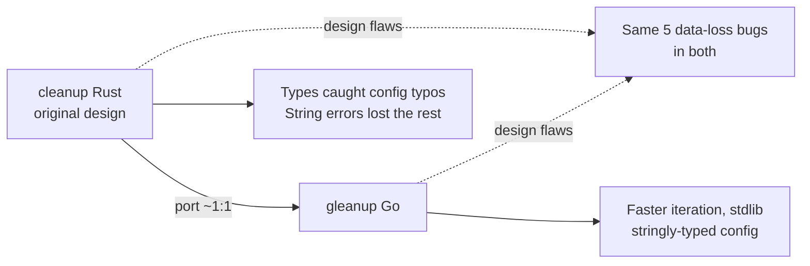

# cleanup (Rust) vs gleanup (Go): Code Review & Language Recommendation

Date: 2026-11-19 · Scope: `cleanup/` (Rust workspace, ~7.0k LOC incl. tests) and `gleanup/` (Go module, ~5.1k LOC + 1.25k test LOC).

## TL;DR

- **gleanup is a near line-for-line port of cleanup.** Almost every bug below exists in **both**, because the design was ported, not re-derived. Language choice was not the deciding factor in correctness. The design was.
- **Five data-loss bugs reproduced** (dry-run, both binaries, identical output). The worst: a "skipped" (fresh) Orca workspace still gets deleted when the defunct-tools scanner selects its parent `.orca` directory.
- Rust won where it used its type system: config enums reject typos, and `match` is exhaustive. It gave that advantage back with `Result<_, String>` errors, a TUI dependency inside `core`, hand-rolled stdlib replacements, and no clippy/rustfmt on the toolchain.
- Go won on iteration speed, stdlib coverage, layering, and tooling hygiene (`go vet` and `-race` ran green). It lost type safety at the config boundary: string enums silently fall back to `rm -rf`.
- **Recommendation:** use **Go** for CLI/TUI tools like this one, where filesystem and subprocess orchestration plus a TUI dominate and iteration speed matters. Pick **Rust** when correctness invariants can be encoded in types, or when performance, binary size, or embedding matters. Either way, fix the shared design flaws first (section 4).

---

## 1. Verification run

| Check | gleanup (Go) | cleanup (Rust) |
|---|---|---|
| Build | ✅ 0.7s | ✅ (release binary present) |
| Tests | ✅ 6 pkgs, 20 `Test*` funcs, `-race` clean | ✅ 30 `#[test]` |
| Static analysis | `go vet` ✅; staticcheck/govulncheck not installed (download was blocked) | ❌ `cargo clippy` **not installed** on toolchain |
| Formatting | ❌ `gofmt -l` → `internal/tui/model.go` | ❌ `cargo fmt` **not installed** |
| Deps hygiene | ❌ `go.mod` untidy (every dep marked `// indirect`) | ✅ workspace deps |
| Repo hygiene | ❌ 6 MB `gleanup/gleanup` binary in tree; whole dir untracked | ❌ **591 `target/` files committed**, 974 MB `target/`, no `.gitignore` |
| Release binary | 6.0 MB | 3.0 MB |

### Reproduced findings (dry run, `PATH=/usr/bin:/bin`, temp HOME)

Fixture: an Orca full-clone workspace on branch `feature` with an unpushed commit and a git-ignored `.env`; a JS project with a **tracked** `build/vite-plugin.js`; a `.cursorrules` file; a config with a typo in a marker key.

| # | Result (identical in both) |
|---|---|
| R1 | `.orca` flagged eligible ("Orca not installed • idle 0d"). The Orca provider marks `ws1` **skip (fresh)**, but `ws1` is "covered by parent", so deleting `.orca` deletes it anyway. |
| R2 | The full clone holding an unpushed branch commit and an ignored `.env` is reported as a "clean nested git tree". |
| R3 | The tracked `web/build/` directory is flagged as a Node build artifact. |
| R4 | `.cursorrules` is flagged at idle 0d. Defunct "auto" tools have no age gate, and the verdict depends on `$PATH`. |
| R5 | `require_sibling_marker` (typo) is silently ignored, so `notrust/target/important.db` is flagged for `rm -rf`. |

---

## 2. Shared bugs (both projects)

Ordered by severity. File references point at the Go version, and the Rust code mirrors each one.

### Critical: data loss

1. **Subsumption overrides safety verdicts (R1).** `ReconcileTargets` and `EffectiveSelected` link children to the nearest dir-like ancestor target, and selecting the parent deletes skipped children. Defunct-tools has dedup rank 0, so `.orca` becomes the parent of every Orca workspace. Locked, dirty, and fresh workspaces are all deleted through the parent. The plain output even labels the skipped child "covered by parent". [reconcile.go:84-105](../../../scratch/gleanup/internal/core/reconcile.go#L84), [defunct.go:249-312](../../../scratch/gleanup/internal/config/defunct.go#L249).
   *Fix:* a parent with any skipped descendant must itself become skipped, or must delete only its eligible children.
2. **Full clones lose unpushed commits, stashes, and ignored files (R2).** `InspectGitTree` checks only `status --porcelain` (which hides ignored files) and detached-HEAD reachability. Commits on local branches with no upstream, stashes, and `.env` files are lost when an Orca full clone or a nested clone inside a defunct dir is `rm -rf`'d. [git.go:102-190](../../../scratch/gleanup/internal/core/git.go#L102), [orca.go:116](../../../scratch/gleanup/internal/orca/orca.go#L116).
   *Fix:* also require `git for-each-ref --format='%(upstream:track)'` to show no `ahead` entries, `git stash list` to be empty, and `status --ignored` to be empty (or warn).
3. **Git safety fails open.** Any `runGit` failure returns `("", false)`, which is treated as clean:
   - `status` fails → `dirtyFiles = 0`.
   - `rev-parse --is-inside-work-tree` fails (broken `gitdir:` pointer, moved main repo, `index.lock`) → every git check is skipped and only age decides.
   - `RemoveWorktree` then falls back to `os.RemoveAll` whenever `git worktree remove --force` refuses, bypassing git's own guard.

   [git.go:115-145, 193-215](../../../scratch/gleanup/internal/core/git.go#L115).
   *Fix:* treat inspection errors as `Skipped(InspectFailed)`, and never fall back to raw `rm -rf` after git refuses.
4. **Tracked source deleted as "artifacts" (R3, R4).** The artifact rules never check git tracking. Any `dist/`, `build/`, or `coverage/` below a `package.json` is removed, including committed `build/` script dirs (the exact case your CLAUDE.md warns about). Defunct-tool files such as `.cursorrules`, `.clinerules`, and `.continue/` are typically committed team config.
   *Fix:* skip anything with tracked files (`git ls-files --error-unmatch` / `git check-ignore`) unless explicitly forced.
5. **The defunct "auto" policy is PATH-dependent and has no age gate (R4).** Run from cron, launchd, `sudo`, or a minimal shell, and every tool looks uninstalled. `auto` and `defunct` set no `RequireStaleDays`, so active, fresh directories qualify at idle 0d. Generic binary names (`pi`, `cn`) make this worse. [defunct.go:108-130](../../../scratch/gleanup/internal/config/defunct.go#L108).
6. **Config typos silently disable guards (R5).** Neither project rejects unknown keys (Go: `toml.MetaData.Undecoded()` is unused; Rust: no `#[serde(deny_unknown_fields)]`). A misspelled marker key turns a guarded rule into "delete every `target/`". A user `rules` override also replaces the category's rules wholesale, and broad patterns like `names=["*"]` are never rejected.

### High

7. **Ctrl+C during deletion reports a falsehood.** In `PhaseDeleting`, Ctrl+C returns `QuitCancelled`, so main prints "cancelled: no files were deleted". Meanwhile the deletion goroutine or thread is killed mid-`rm -rf`, and `git worktree prune` never runs. [state.go:659-664](../../../scratch/gleanup/internal/tui/state.go#L659), [tui/mod.rs:101](../../../scratch/cleanup/crates/cleanup-core/src/tui/mod.rs#L101).
8. **Worktree scope escape.** `git worktree list` returns worktrees **anywhere on disk**, and they are offered for deletion even when outside `--root`. [worktree.go:39](../../../scratch/gleanup/internal/worktree/worktree.go#L39).
9. **`providers.orca.age_days` is dead config.** Both binaries use `providers.worktrees.age_days` for every provider. [main.go:80](../../../scratch/gleanup/cmd/gleanup/main.go#L80), [main.rs:86](../../../scratch/cleanup/crates/cleanup/src/main.rs#L86).
10. **A defunct dir that is itself a git repo is never inspected.** `inspectNestedGitTrees` skips `p == dir`, so `.orca/.git` or a `.cursor` clone is removed unchecked. [defunct.go:320](../../../scratch/gleanup/internal/config/defunct.go#L320).
11. **`RemoveDirAfterWorktrees` aborts halfway.** The first worktree failure returns, leaving some worktrees removed, the container intact, and prune skipped.

### Security

12. **Running git inside untrusted repos runs their config.** `git status` honors repo-local `core.fsmonitor` and similar settings, which gives code execution when scanning cloned or third-party repos. Inherited `GIT_DIR` / `GIT_WORK_TREE` env vars override `-C` and redirect every check to another repo.
    *Fix:* run git with `-c core.fsmonitor=false -c core.hooksPath=/dev/null`, a scrubbed `GIT_*` env, and an absolute git path.
13. **TOCTOU on deletes.** `ensureNotSymlink` checks only the leaf, then calls `RemoveAll` by path, so a parent component swapped for a symlink between scan and delete redirects the deletion. That is low risk for a single-user tool, but `openat`/`unlinkat`-relative deletion (or re-validating that the canonical path is still under the root) closes it.
14. **Root guard is too narrow.** It refuses only `/` and exactly `$HOME`, so `/Users`, `/System`, `~/Library`, or `/` behind a bind mount are accepted. `HOME` comes from the environment rather than `os.UserHomeDir()` / getpwuid. The validated canonical root is discarded and the raw string is returned.
15. **Porcelain output parsed without `-z`.** Paths containing newlines break the record parser.

### Medium: correctness and performance

- Each enabled cleaner runs its **own full walk** of the root (about 10 concurrent full traversals), and `NewestRealFileMtime` walks entire worktrees, `node_modules` included. One shared walk feeding all matchers would be N× faster.
- Failures are printed twice in plain delete (`ExecutePlainDelete` callback, then `PrintFinalSummary`).
- `-y` means `--delete`. By convention `-y` means "assume yes", so `-yf` reads as harmless.
- Rust only: a panicked scanner thread is silently dropped (`if let Ok(part) = handle.join()`), which produces a partial scan with no warning.
- Go only: when the TUI quits mid-scan, producers block forever on a full 64-slot channel (a goroutine leak; harmless only because the process exits).

---

## 3. Language-specific antipatterns

### gleanup (Go)

| Issue | Where |
|---|---|
| **Stringly-typed enums decide deletion.** `rule.Kind != "dir"` and `DeleteStrategy == "empty_contents"`, with anything else defaulting to **`RemoveDirAll`**. A typo like `empty-contents` deletes the whole directory. | [engine.go:43,62-65](../../../scratch/gleanup/internal/config/engine.go#L62) |
| Sum types emulated as tagged structs (`DeleteStrategy{Kind, MainRepo, Worktrees}`, `SkipReason{Kind, …}`). Invalid combinations compile, and `switch` has a runtime `default: unknown strategy`. | `core/types.go` |
| Bad glob patterns are silently ignored (`ok, _ := path.Match`). | engine.go:148,160 |
| `go.mod` untidy, `gofmt` failing, compiled binary sitting in the source dir. | — |
| Different glob semantics from the Rust version (`path.Match` vs `glob-match` with `**` and `{a,b}`), yet gleanup deliberately reads `~/.config/cleanup/config.toml`. The "shared" config does not behave the same. | schema.go:146-166 |
| `--dry-run`/`--delete` override semantics hand-rolled with custom `pflag.Value`s, and the man page hand-written. | cli.go, man.go |

### cleanup (Rust)

| Issue | Where |
|---|---|
| **`Result<T, String>` everywhere.** This throws away typed errors, `?` composition, and source chains. Use `thiserror` in libraries and `anyhow` in the binary. | all crates |
| **Layering inversion:** `cleanup-core` contains the TUI and depends on `ratatui`, so the config, orca, and worktree crates all compile ratatui. Five crates for about 6k LOC is ceremony without a payoff. | cleanup-core/Cargo.toml |
| Dead or confusing code: `project_name_for` contains a closure that discards its result (`let _ = p; Path::new("")`) next to a misleading "Leak-free" comment. | [root.rs:52-60](../../../scratch/cleanup/crates/cleanup-core/src/root.rs#L52) |
| Stdlib gaps hand-rolled: PATH lookup, `is_executable`, and a single-segment-only glob for `app_paths` (`~/x/*/y` silently never matches). Use the `which` and `glob` crates. | defunct.rs:465-532 |
| `#[allow(clippy::too_many_arguments)]` on an 8-positional-arg function. Use an options struct. Go has the same signature. | git.rs:98 |
| `target/` committed, and clippy and rustfmt missing from the toolchain, so the lints the allow-attributes imply were never actually run. | — |
| Behavioral drift from the Go port: Rust treats a **symlinked** `.git` as a full clone (`is_file()`), while Go treats it as linked (`!IsDir()`), leading to different delete strategies. | orca lib.rs vs orca.go |

### Where Rust did better

- Config enums (`TargetKind`, `RuleDeleteStrategy`, `ToolPolicy`) make `kind="directory"` or `delete_strategy="empty-contents"` a **parse error**, not a silent `rm -rf`.
- Exhaustive `match` on `DeleteStrategy`, with no runtime "unknown" arm.
- `thread::scope` plus rayon give race-freedom by construction, and `saturating_add` and `div_ceil` handle arithmetic edges.
- `clap` derive plus `clap_mangen` generate flags, help, conflicts, and the man page from one definition, and a test asserts every flag has a short form, a long form, and help text.
- `ratatui::init()` installs a panic hook that restores the terminal.

### Where Go did better

- Cleaner package layering (`internal/tui` separate from `core`).
- Stdlib covers `exec.LookPath`, `filepath.Glob`, `WalkDir`, `embed`, and `%w` error wrapping, so less code is hand-rolled and there are fewer divergences.
- Sub-second builds, a free race detector (`-race` ran clean), and gofmt/vet in the default toolchain.
- More test LOC per production LOC (1252 / 5139), and tests exist in every package.
- Bubble Tea's message model made async scan and delete events natural (channel → `tea.Cmd`). The ratatui version hand-rolls a poll loop with tuned sleep intervals.

---

## 4. Fix first (language-independent)

1. Propagate **skipped** status upward through subsumption, so a parent containing a skipped child is never auto-deleted.
2. Make git inspection **fail closed**, and add unpushed-commit, stash, and ignored-file checks. Never fall back to `rm -rf` when git refuses.
3. Never delete **git-tracked** paths without an explicit flag.
4. Give defunct tools an age gate always. Prefer an explicit allow-list over PATH-sniffing, and print the PATH that was checked.
5. Reject unknown config keys (`Undecoded()` / `deny_unknown_fields`), and in Go replace string enums with validated types.
6. Make Ctrl+C during delete wait for the current item, run prune, and report a true partial result.
7. Constrain every target to the canonical root, worktrees included.
8. Harden git invocation (`-c core.fsmonitor=false`, scrubbed `GIT_*` env).
9. Add `.gitignore` (`target/`, `gleanup/gleanup`), run `go mod tidy`, `gofmt`, and `rustup component add clippy rustfmt`.

---

## 5. Process comparison and recommendation

What building both versions shows:

1. **The port copied every defect.** Equivalent output on every repro means review effort should go into the *safety model* (what counts as safe to delete), not the language. A second implementation is only a check if it is derived from a spec, not from the first implementation.
2. **Rust's safety advantage only applies where you encode invariants.** Rust caught typo'd enums at the config boundary, and nothing else in the bug list, because the dangerous logic (git verdicts, subsumption, PATH sniffing) is plain boolean logic that neither type system checks. Meanwhile `String` errors and missing clippy cancelled much of Rust's rigor.
3. **Go was cheaper to get right operationally.** It had fewer hand-rolled utilities, better layering, the race detector, and sub-second builds. Its one structural weakness (string enums) is fixable with a validated config-loading step.
4. **TUI ergonomics:** Bubble Tea's Elm architecture fits progress-streaming tools well. Ratatui is more flexible but needs a hand-written event loop. Both TUIs are about the same size (~1.8–2.1k LOC).
5. **Distribution:** both produce single static binaries. Rust's is half the size (3 MB vs 6 MB), which rarely matters for a dev tool.

### Recommendation

| Pick **Go** (default for this class of tool) when… | Pick **Rust** when… |
|---|---|
| The tool is mostly filesystem walking, subprocess orchestration (`git`), config, and a TUI | You can encode core invariants in types (e.g. a `SafeToDelete` token that only verified inspection can mint) |
| Fast iteration and short review loops matter more than peak performance | You need hot-loop throughput, `no_std`/embedding, a library others link against, or minimal binaries |
| You want vet, race, and fmt to work with zero setup | The team will actually enforce clippy (pedantic), `thiserror`/`anyhow`, and newtypes |

For **cleanup/gleanup specifically**, continue with **gleanup (Go)** and retire the Rust copy. Before any `--delete` use, apply section 4 and these Go-specific guards:

- Parse config into typed enums with validation (reject unknown keys and unknown `kind`/`delete_strategy` values).
- Introduce an unexported `verifiedTarget` type that only the inspection code can construct, and make `ExecuteDeletions` accept only that type. This recovers most of Rust's "make illegal states unrepresentable" benefit.
- Add a single shared walker with pluggable matchers.
- Add CI: `gofmt -l`, `go vet`, `staticcheck`, `govulncheck`, `go test -race`, plus the five repro fixtures above as regression tests.

Keeping two parallel implementations doubles the surface for exactly the class of bugs found here, without adding a check.
